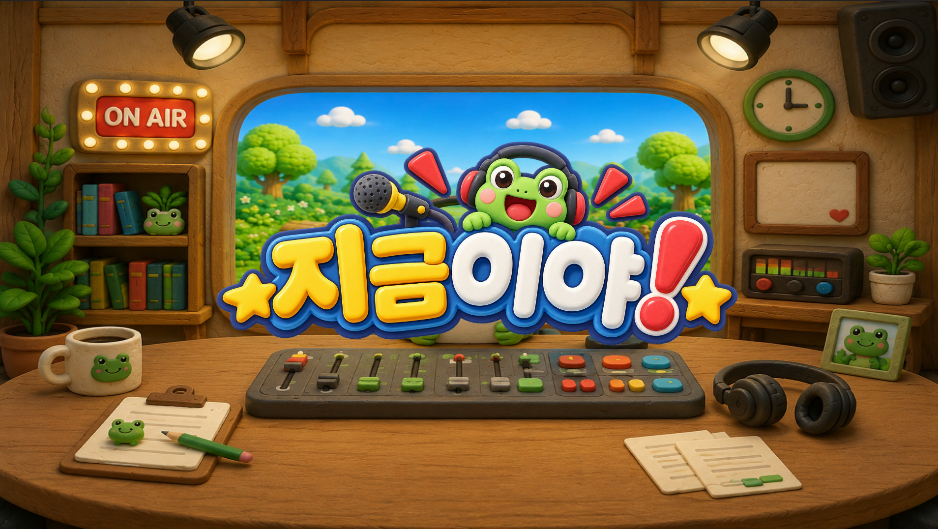
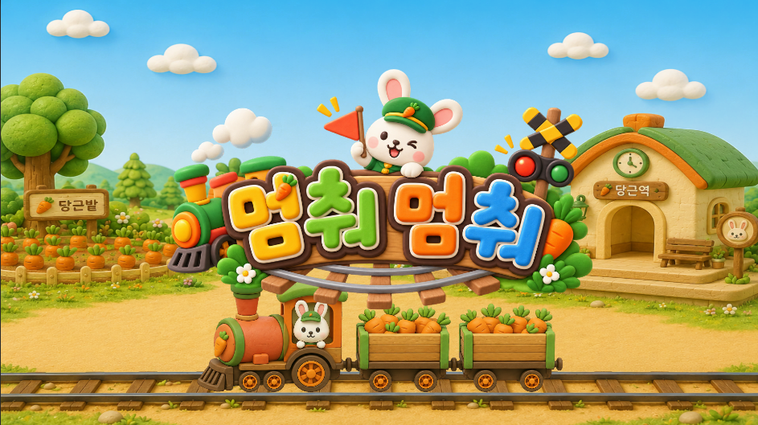
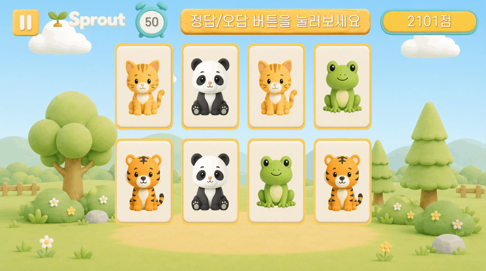

# MemoLeaf | Yang Wonkyu — Unity Client Portfolio

**MemoLeaf(메모리프)**는 어르신의 인지건강 관리와 치매 예방 활동을 지원하는 것을 목표로, 다섯 가지 인지 영역을 게임으로 훈련하도록 기획된 콘텐츠입니다.

저는 Unity/C# 클라이언트 개발자로서 **사용자 입력부터 난이도 구성, 판정, 피드백, 결과 수집까지 완결되는 게임 콘텐츠**를 구현했습니다. 현재 시지각·협응력·집중력·속도 영역의 콘텐츠를 제작했으며, 분석력 영역은 향후 확장 범위입니다.

기존 프로젝트 구조를 빠르게 파악하고, 기획 의도를 플레이 가능한 기능으로 옮기는 데 강점이 있습니다. 단순한 미니게임 나열보다 콘텐츠가 늘어나도 유지할 수 있는 공통 흐름, 데이터 구조, 웹 연동과 사용성 개선을 함께 고민합니다.

> 회사 프로젝트의 원본 코드와 내부 리소스는 포함하지 않습니다. 이 저장소는 공개 가능한 GIF·스크린샷, 재구성한 샘플과 구현 설명으로 기여 범위와 문제 해결 과정을 보여줍니다.

## Five Cognitive Themes

| 인지 영역 | 상태 | 콘텐츠 구성 |
|---|---|---|
| 시지각 | 구현 | 짝꿍찾기, 거품팡팡, 그림자콕, 담아담아, 히든캐치 |
| 속도 | 구현 | 멈춰멈춰, 새 모이 주기 |
| 집중력 | 구현 | 모아이 관찰, 재활용 분리수거, 지금이야 |
| 협응력 | 구현 | 복잡한주문기억, 색선게임, 선긋기게임, 시계 그리기 |
| 분석력 | 확장 예정 | 향후 콘텐츠 영역 |

각 게임은 같은 규칙을 반복하지 않고, 목표 인지 영역에 맞춰 기억·탐색·억제·타이밍·손-눈 협응 과제를 서로 다른 입력 방식으로 구성합니다.

## UX for Senior Players

- 오프닝 → 설명 → 시범 → 직접 연습 → 본 게임으로 이어지는 단계적 튜토리얼
- 입력 가능한 상태를 명확히 분리해 연속 터치와 판정 중 오입력 방지
- 일정 시간 입력이 없으면 정답 위치·다음 행동을 안내하는 자동 힌트
- 텍스트, 사운드, 애니메이션과 파티클을 결합한 즉각적인 정오답 피드백
- 씨앗부터 나무까지 난이도를 나누고 정확도·반응시간에 따라 적응형으로 조정

## Core Engineering

| 영역 | 구현 경험 |
|---|---|
| 콘텐츠 프레임워크 | 공통 게임 생명주기, 타이머, 점수·콤보, 튜토리얼, 적응형 난이도, 라운드 전환과 결과 수집 |
| 데이터 설계 | ScriptableObject 기반 콘텐츠 설정, 난이도별 규칙, 진행도 저장, 저장 데이터 버전 마이그레이션 |
| 입력과 판정 | 클릭, 드래그 앤 드롭, 연속 누르기, Go/No-Go, 순서 기반 그리기와 위치 오차 판정 |
| WebGL·서비스 연동 | JavaScript 브리지 결과 전송, JSON 직렬화, API 요청, 원격 이미지 다운로드와 런타임 적용 |
| 제작 생산성 | 반복 데이터 생성을 위한 Unity Editor 도구, 공통 UI·튜토리얼·디버그 기능 |
| 연출과 피드백 | UGUI, TextMeshPro, DOTween, ParticleSystem, Shader/Material 기반 즉시 피드백 |

## What to Review First

1. **공통 콘텐츠 프레임워크**  
   게임 생명주기, 타이머, 점수·콤보, 적응형 난이도와 결과 전송을 공통화하고 각 게임은 고유 문제 생성과 판정에 집중하도록 구성했습니다.

2. **담아담아 — 서비스 연동**  
   주문 기억과 드래그 판정에 STT 테마 선택, 원격 이미지 다운로드, API 결과 전송을 연결했습니다.

3. **선긋기게임 — 알고리즘과 입력 상태**  
   다각형·별 좌표를 절차적으로 생성하고 포인터 진입·이탈·해제 상태를 관리해 순서 기반 그리기를 판정했습니다.

4. **재활용 분리수거 — 데이터와 제작 도구**  
   품목·분류 규칙을 ScriptableObject로 분리하고 반복 에셋을 생성하는 Unity Editor 도구를 제작했습니다.

5. **멈춰멈춰 — 실시간 상태와 오차 판정**  
   매 프레임 속도·제동·이동 거리를 계산하고 정차 위치 오차, 가짜 역과 날씨 조건을 난이도에 반영했습니다.

**Code evidence:** [공개용 핵심 구현 코드와 설계 노트](docs/core-implementation.md)에서 적응형 난이도, 순서 기반 선긋기 입력, 런타임 테마 로딩과 Editor 데이터 생성 예제를 확인할 수 있습니다.

## Implemented Content

| 인지 영역 | 콘텐츠 | 핵심 구현 |
|---|---|---|
| 시지각 | 짝꿍찾기 | 카드 프리뷰·플립·매칭, 난이도별 그리드, 입력 잠금, 콤보와 결과 수집 |
| 시지각 | 거품팡팡 | 단계별 버블 문제 구성, 선택 입력과 판정, 자동 힌트, 보드 단위 결과 수집 |
| 시지각 | 그림자콕 | 색상 조각 드래그 앤 드롭, 실루엣 매칭, 셰이더 기반 색상 확산 |
| 시지각 | 담아담아 | 주문 기억, 상품 드래그와 카트 검증, STT 테마 선택, 원격 이미지·결과 API 연동 |
| 시지각 | 히든캐치 | 목표 동물 기억, 유사 오답 생성, 드래그 앤 드롭 판정과 실루엣 힌트 |
| 속도 | 멈춰멈춰 | 연속 감속, 목표·가짜 역 구성, 정차 오차 판정, 날씨별 시야·제동 변화 |
| 속도 | 새 모이 주기 | 제한된 먹이 수, 동물 선택 판정, 장애물과 난이도별 라운드 구성 |
| 집중력 | 모아이 관찰 | 장신구 조합 기억, 유사 오답 생성, 위치 교환과 선택 판정 |
| 집중력 | 재활용 분리수거 | 품목·카테고리 데이터, 수거 일정 규칙, 드래그 분류, Editor 데이터 생성 도구 |
| 협응력 | 복잡한주문기억 | 대화형 주문 제시, 그리기 입력, 라운드 잠금, AI 판정 API 연결 |
| 협응력 | 색선게임 | 색상 기억 단계와 재현 단계 분리, 선분별 팔레트 입력, 정오답·힌트 상태 관리 |
| 협응력 | 선긋기게임 | 절차적 다각형·별 생성, 순서 기반 포인터 판정, 반복 방지와 idle hint |
| 협응력 | 시계 그리기 | 시간 문제 생성, 간접 시간 표현, 시·분침 각도와 그리기 결과 판정 |

### Recent Work — 지금이야



좌우 화면의 방송 상태를 확인하고 조건에 맞는 순간에만 반응하는 Go/No-Go 콘텐츠입니다. 난이도별 자극 규칙, 목표 반응시간, 입력 가능 상태와 시간 초과 판정을 구성했습니다.

## Selected Engineering Case Studies

### 1. 담아담아 — 데이터·음성·네트워크가 연결된 주문 기억 콘텐츠

제시된 상품 주문을 기억한 뒤 선반에서 물건을 골라 카트에 담는 콘텐츠입니다. 단순 드래그 게임을 넘어 테마 선택, 동적 상품 구성, 주문 미리보기, 힌트와 서버 통신을 하나의 라운드 흐름으로 연결했습니다.

- 난이도에 따라 주문 데이터와 오답 상품 풀을 동적으로 생성
- 선반·카트 UI의 드래그 상태와 자동 제출 흐름 관리
- STT 인식 결과로 테마를 선택하고 네트워크 준비 상태와 게임 시작을 동기화
- API에서 테마 이미지와 상품 리소스를 내려받아 런타임 적용
- 정답 주문 비교, 재청취, 자동 힌트와 라운드 결과 전송

### 2. 멈춰멈춰 — 연속 감속과 위치 오차 판정



목표 역을 기억한 뒤 브레이크를 길게 눌러 정확한 위치에 정차하는 콘텐츠입니다. 단순 버튼 정답이 아니라 매 프레임 속도와 이동 거리를 갱신하고, 목표 지점과의 오차로 결과를 판정합니다.

- 속도·제동력·정차 허용 범위를 난이도별로 조정
- 목표 역과 가짜 역을 섞어 기억·억제 과제를 구성
- 맑음·안개·눈 상태에 따라 시야와 제동 특성을 변경
- 정차 오차를 `PERFECT / GOOD / MISS`로 구분하고 보너스에 반영
- 튜토리얼에서 시간 정지와 입력 유도를 결합해 조작 학습 지원

### 3. 선긋기 — 절차적 도형 생성과 포인터 상태 관리


순서대로 배치된 점을 연결해 도형을 완성하는 콘텐츠입니다. 정해진 이미지에만 의존하지 않고 다각형과 별의 좌표를 생성하며, 포인터 진입·이탈·해제 상태를 관리합니다.

- 다각형·별 좌표를 알고리즘으로 생성해 콘텐츠 확장 비용 절감
- 요구 점, 이미 연결된 점, 마지막 닫기 단계를 분리해 순서 판정
- 난이도 범위 안에서 도형이 반복되지 않도록 bag 방식 선택
- 입력이 없을 때 다음 목표를 안내하는 idle hint와 그리기 사운드 처리
- 라운드 결과와 보드 단위 데이터를 분리해 전송

### 4. 재활용 분리수거 — 데이터 기반 분류 규칙과 제작 도구

요일별 수거 일정에 맞춰 품목을 올바른 분리수거함으로 드래그하는 콘텐츠입니다. 품목과 분류 규칙을 코드에 고정하지 않고 데이터로 관리하고, 반복 제작을 줄이는 Editor 도구를 함께 구성했습니다.

- `ScriptableObject`로 품목 이미지·카테고리 데이터를 분리
- 난이도별 사용 카테고리와 날짜별 수거 일정을 구성
- 드롭 대상과 품목 카테고리를 비교하고 입력 잠금·피드백 처리
- 품목 데이터 에셋을 일괄 생성하는 `EditorWindow` 제작
- 튜토리얼과 본 게임이 같은 데이터·판정 규칙을 공유

## Existing Content Highlights

### Hidden Catch


문제 동물을 일정 시간 제시한 뒤 여러 동물 중 정답을 찾아 드롭하는 콘텐츠입니다.

- 난이도별 목표 수·등장 수·유사 동물 수·노출 시간 제어
- 드래그 앤 드롭 정답 판정과 입력 잠금
- 정답 실루엣 해금, 파티클, 클릭 피드백과 자동 힌트

Details: [docs/hidden-catch.md](docs/hidden-catch.md)

### Shadow Kok


동물 실루엣을 보고 알맞은 색상 조각을 드래그해 맞추는 콘텐츠입니다.

- 정답색과 오답색 팔레트 구성
- UI 드래그 복제와 Drop 판정
- 커스텀 셰이더 기반 색상 확산 연출
- 정답 조각을 안내하는 머티리얼 아웃라인 힌트

Details: [docs/shadow-kok.md](docs/shadow-kok.md)

### Pair Match



카드 프리뷰 후 뒤집힌 카드를 기억해 같은 짝을 맞추는 콘텐츠입니다.

- 단계별 카드 수·그리드·빈 슬롯 구성
- 프리뷰, 플립, 비교, 자동 힌트를 순차 흐름으로 제어
- 판정 중 입력 잠금과 매치·오답 피드백
- 점수, 콤보와 결과 데이터 수집

Details: [docs/pair-match.md](docs/pair-match.md)

## Reusable Content Architecture

여러 콘텐츠에서 반복되는 기능은 공통 게임 매니저 흐름으로 관리하고, 각 게임은 라운드 구성과 고유 판정에 집중하도록 구성했습니다.

```text
Opening / Tutorial
        ↓
Start Game → Build Round → Accept Input
        ↑                     ↓
 Next Round ← Feedback ← Validate Answer
        ↓
Result Collection → WebGL / API
```

- 공통 영역: 제한시간, 점수·콤보, 속도 보너스, 적응형 난이도, 재시작, 결과 전송
- 콘텐츠 영역: 문제 생성, 입력 해석, 정답 판정, 게임별 연출
- 데이터 영역: 게임 정의, 난이도 규칙, 진행도와 최고 기록

구현 흐름도: [docs/content-flowcharts.md](docs/content-flowcharts.md)

## AI-Assisted Development Workflow

생성형 AI는 구현을 대신 맡기는 도구가 아니라 **기존 코드 탐색과 가설 검증 속도를 높이는 개발 도구**로 사용합니다.

1. 요구사항과 현재 코드의 책임 범위를 먼저 정의합니다.
2. AI로 관련 흐름을 탐색하고 구현·리팩터링 후보를 만듭니다.
3. 씬 참조, 입력 상태, 시간 흐름, 난이도 규칙과 기존 공통 구조를 기준으로 결과를 검토합니다.
4. Unity 실행 결과와 로그를 확인하며 코드와 파라미터를 직접 조정합니다.
5. 변경 범위를 다시 확인하고 기존 콘텐츠에 미치는 영향을 점검합니다.

## Tech Stack

`Unity` `C#` `UGUI` `TextMeshPro` `DOTween` `ParticleSystem` `Shader Graph` `ScriptableObject` `UnityWebRequest` `WebGL Interop` `Git`

## Public Evidence Policy

이 저장소에는 회사 프로젝트의 원본 코드, 비공개 에셋, 내부 데이터 테이블과 빌드 산출물을 업로드하지 않습니다.

공개 가능한 범위에서 다음 자료만 사용합니다.

- 직접 제작했거나 공개 권한을 확인한 GIF·스크린샷
- 공개용으로 재작성한 샘플 코드
- 구현 흐름도와 기술 설명
- 문제 해결 과정과 설계 의도

자세한 기준: [docs/evidence-policy.md](docs/evidence-policy.md)

## Contact

- Name: 양원규
- Role: Unity Client Developer
- Portfolio: PDF portfolio available on request
