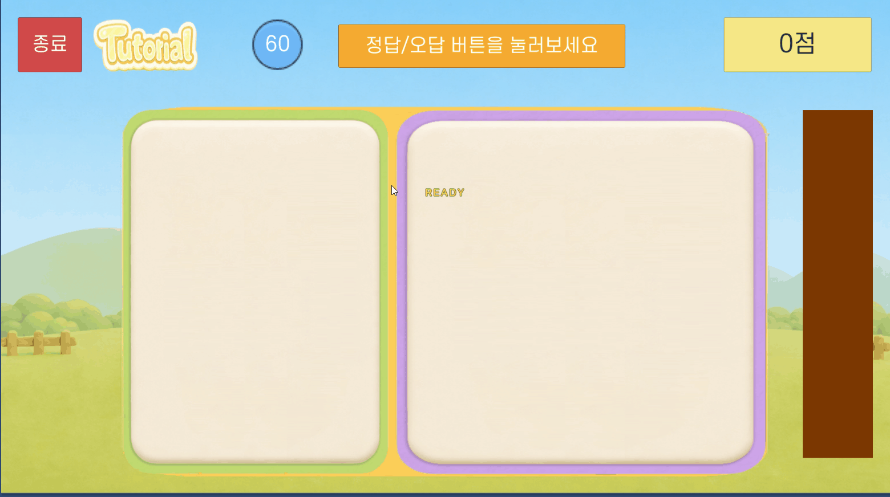
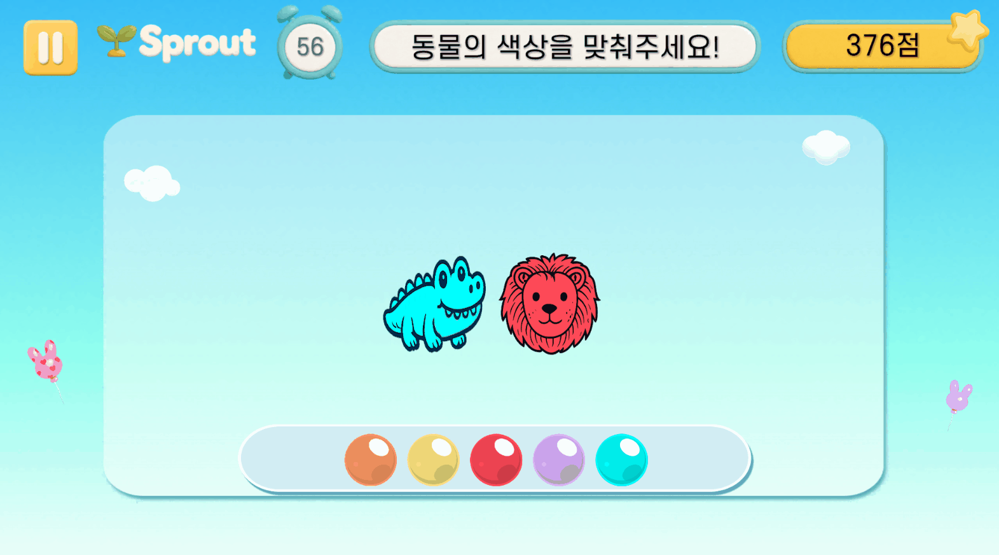

# Yang Wonkyu - Unity Client Portfolio

Unity/C# 기반 게임 클라이언트 개발 포트폴리오입니다.

회사 프로젝트의 원본 코드와 내부 리소스는 포함하지 않습니다. 이 저장소는 공개 가능한 개인 프로젝트, 재구성한 샘플 코드, GIF/스크린샷, 구현 설명을 통해 Unity 클라이언트 개발 역량을 보여주기 위한 용도입니다.

## Profile

- Position: Unity Client Developer
- Strengths: UI flow, in-game presentation, shader/particle feedback, drag-and-drop interaction, screen state control
- Tech: Unity, C#, UGUI, TextMeshPro, DOTween, ParticleSystem, Shader Graph, ScriptableObject, FSM, Git
- Focus: 기존 Unity 프로젝트 구조를 파악하고, UI/연출/콘텐츠 기능을 실제 동작으로 구현하는 클라이언트 개발

## What To Review First

1. [Hidden Catch](docs/hidden-catch.md)
   - 난이도별 목표/스폰/유사 동물 파라미터 제어
   - 문제 제시 후 드래그 앤 드롭 정답 판정
   - 직접 제작한 정답 파티클, 클릭 피드백, 힌트 아웃라인 처리

2. [Shadow Kok](docs/shadow-kok.md)
   - 동물 실루엣과 색상 팔레트 기반 정답 매칭
   - 색상 드래그 앤 드롭 입력 처리
   - 직접 제작한 색상 확산 셰이더, 정답 파티클, 자동 힌트

3. [Pair Match](docs/pair-match.md)
   - 난이도별 카드 배치와 빈 슬롯 처리
   - 프리뷰, 카드 플립, 매칭 판정, 자동 힌트
   - 카드 플립/매치 파티클/콤보 피드백/결과 데이터 수집 흐름

4. [Content Flowcharts](docs/content-flowcharts.md)
   - 세 콘텐츠의 입력, 상태, 판정, 연출 흐름 요약
   - 채용자가 빠르게 확인할 수 있는 구현 구조도

5. [Portfolio Evidence Policy](docs/evidence-policy.md)
   - 공개 가능한 자료와 비공개 자료 구분
   - 회사 코드 대신 설명/GIF/재구성 샘플로 증명하는 방식

## Representative Work

### 1. Hidden Catch

문제 동물을 일정 시간 제시한 뒤, 여러 동물 중 정답을 찾아 드롭하는 Unity 미니게임입니다. 난이도에 따라 목표 수, 등장 동물 수, 유사 동물 수, 문제 노출 시간을 조절했습니다.

- Difficulty-based round parameter control
- Drag-and-drop answer validation
- Correct answer reveal presentation with DOTween and custom particle feedback
- Idle hint outline using material thickness animation

Details: [docs/hidden-catch.md](docs/hidden-catch.md)

### 2. Shadow Kok

동물 실루엣을 보고 알맞은 색상 조각을 드래그해 맞추는 Unity 미니게임입니다. 정답 색상은 셰이더 기반 확산 연출로 공개되고, 정답 동물 슬롯으로 이동하는 흐름을 구성했습니다.

- Color palette generation with answer/distractor colors
- Drag clone handling for UI drop interaction
- Custom shader-based color spread presentation
- Idle hint outline for the correct color piece

Details: [docs/shadow-kok.md](docs/shadow-kok.md)

### 3. Pair Match

카드 프리뷰 후 뒤집힌 카드를 기억해 같은 짝을 맞추는 Unity 미니게임입니다. 단계별 카드 수와 레이아웃, 빈 슬롯, 플립 연출, 매칭 판정, 콤보 점수를 관리했습니다.

- Stage-based card layout and grid sizing
- Preview and card flip sequence
- Match/wrong answer handling with input lock and particle feedback
- Score, combo, and result collection

Details: [docs/pair-match.md](docs/pair-match.md)

## Content Flowcharts

각 콘텐츠별 구현 흐름은 별도 문서에 모았습니다.

- [Hidden Catch Flowchart](docs/content-flowcharts.md#hidden-catch)
- [Shadow Kok Flowchart](docs/content-flowcharts.md#shadow-kok)
- [Pair Match Flowchart](docs/content-flowcharts.md#pair-match)

## Presentation Work

이 포트폴리오의 연출 요소는 단순히 배치된 에셋을 연결한 것이 아니라, Unity 클라이언트 기능 흐름에 맞춰 직접 제작하거나 구현한 피드백입니다.

- Shadow Kok: 정답 색이 검은 실루엣에서 퍼져나가는 `ShadowSpread` 셰이더 제작 및 적용
- Shadow Kok: 정답 색상 조각 힌트를 위한 아웃라인 머티리얼 두께 애니메이션 구현
- Hidden Catch: 정답 처리 시 실루엣 해금, 스케일 반응, 파티클 피드백 구현
- Pair Match: 카드 플립, 매치 성공 파티클, 카드 스케일 반응, 콤보 점수 팝업 구현

## Public Code Policy

이 저장소에는 회사 프로젝트의 원본 코드, 내부 리소스, 비공개 에셋, 데이터 테이블, 빌드 산출물을 업로드하지 않습니다.

포함된 GIF는 공개 가능 여부를 확인한 결과물만 사용해야 합니다. 공개 권한이 불명확한 경우 해당 GIF는 제거하고 설명 문서만 유지합니다.

공개 가능한 범위에서 다음 자료만 포함합니다.

- 개인 프로젝트 코드
- 공개용으로 재작성한 샘플 코드
- 직접 제작했거나 공개 가능한 GIF/스크린샷
- 구현 흐름도와 기술 설명
- 문제 해결 과정과 설계 의도

## Contact

- Name: 양원규
- Role: Unity Client Developer
- Portfolio: PDF portfolio available on request
