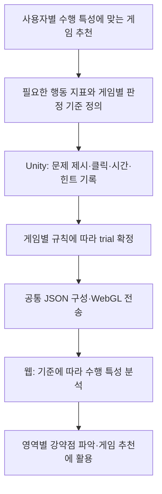

# MemoLeaf | 양원규 · Unity 클라이언트 포트폴리오

**5개 동물 테마 · 현재 19종 · 총 50종을 목표로 하는 인지 훈련 미니게임 프로젝트**

메모리프는 어르신의 인지건강 관리 활동을 지원하고 단기기억 등을 훈련하는 것을 목적으로 기획한 콘텐츠입니다. 시지각·협응력·집중력·속도·분석력의 다섯 인지 영역을 기획 배경으로 두고, 짧은 설명과 터치·드래그 중심의 조작으로 서로 다른 과제를 구성합니다. 동물 테마별 구성은 아래의 현재 게임 목록을 기준으로 합니다.

저는 **Unity/C# 클라이언트 개발**을 담당하며, 게임별 문제 생성, 입력과 판정, 난이도 구성, 튜토리얼, 피드백 연출, WebGL 결과 기록을 구현·개선했습니다. 게임의 규칙을 구현하는 데서 끝내지 않고, 화면에서 이해할 수 있는 문제인지와 안내·입력·측정의 흐름이 일치하는지를 함께 다뤘습니다. 또한 **다른 개발자가 만든 게임에도 적용하는 trial 결과 전송, 웹 시작 난이도 수신, 클릭 파티클 공통 컴포넌트**를 제작·연결했습니다.

> 이 저장소는 구현 설명과 소개 이미지를 모은 포트폴리오입니다. 회사 원본 코드·내부 명세·빌드 파일은 포함하지 않습니다. 썸네일은 콘텐츠 소개 이미지이며 플레이 자료는 별도로 연결했습니다.

## 설계 의도 · 점수에서 수행 과정으로

게임 추천에 활용하려면 최종 점수와 성공 여부뿐 아니라 **어떤 문제에서, 무엇을 눌렀고, 얼마나 걸렸으며, 힌트를 사용했는지** 구분할 필요가 있었습니다. 저는 이 목적에 맞춰 게임별 기록 항목과 판정 시점을 정의하고 공통 웹 전송 구조에 연결했습니다. 웹에서는 전달된 데이터를 기준으로 수행 특성과 영역별 강약점을 파악해 게임 추천에 활용합니다.

| 필요했던 구분 | 설계한 기록 | 활용 목적 |
|---|---|---|
| 바로 맞힌 플레이와 오답 후 완성한 플레이 | 제시 순서·실제 클릭 순서·클릭 수·정오답 | 최종 완료 여부에 가려지는 수행 과정 구분 |
| 빠른 오입력과 정확한 반응 | 첫 반응시간·클릭별 시간과 선택 항목 | 반응 속도를 정확도와 함께 해석 |
| 혼자 수행한 경우와 도움을 받은 경우 | 힌트 표시 여부 | 수행 당시의 도움 조건 구분 |
| 세션에서 문제가 나온 시점과 문제 안에서의 반응 | 전체 경과시간·문제 내 입력 시간 분리 | 서로 다른 시간 기준의 혼동 방지 |
| 재시도가 가능한 게임과 즉시 다음 문제로 가는 게임 | 게임별 시행 종료·판정 규칙 | 게임 규칙에 맞게 기록하면서 전송 기능 재사용 |



거품팡팡을 대표로, 필드를 정한 이유와 오답 후 재시도·무응답의 차이를 설명했습니다. **클라이언트의 수집·판정·전송과 웹의 분석·추천 역할을 구분**합니다. 행동 기록은 추천에 활용할 지표이며, 한 번의 게임 결과로 인지 능력을 확정하는 값으로 설명하지 않습니다.

[거품팡팡 trial 설계 사례](docs/trial-data-design.md)

## 대표 플레이

### 짐싸기게임 · 담아담아


짐을 드래그해 놓으면 가방이 접히고, 겹침 판정 결과를 움직임·별 효과·문구로 전달합니다. **공간 배치 규칙을 판정과 접힘 연출로 연결한 사례**입니다.

[좌표 변환과 피드백 구현](docs/bag-packing.md)

### 모아이관찰


제시된 착용품 조합을 비교하고 석상을 선택합니다. Tree에서는 정답과 두 아이템이 같은 오답, 석상의 위치 교환을 함께 사용해 **일부 단서만으로 정답을 찾는 문제를 개선**했습니다. 영상에는 선택 피드백과 다음 문제 전환도 포함됩니다.

[유사 오답 생성과 정답 유일성 검사](docs/moai-observation.md)

## 다른 개발자의 게임에도 적용한 공통 컴포넌트

| 컴포넌트 | 담당 역할 | 게임 측 연결 |
|---|---|---|
| Trial 데이터 전송 | 게임별 시행 데이터를 공통 형식으로 직렬화하고 WebGL 브리지를 통해 웹에 전달 | 문제 구성·선택·정오답·시간을 게임의 판정 시점에 제공 |
| GameLaunchController | 웹이 요청한 시작 난이도를 읽고 지원 단계로 해석하며, 요청값과 실제 적용값 확인 지원 | 게임 매니저가 반환된 난이도를 자신의 문제 생성 규칙에 적용 |
| 클릭 파티클 | 터치·클릭 위치에 시각적 피드백을 주는 공통 프리팹 제공 | 게임 씬에 배치해 일관된 입력 피드백 사용 |

각 게임의 규칙은 게임 매니저가 맡고, 웹 연동과 반복되는 피드백은 재사용할 수 있도록 구성했습니다. `GameLaunchController`는 시작 설정을 제공하며, 정답 판정과 결과 전송까지 대신 처리하는 구조는 아닙니다.

[공통 컴포넌트의 책임과 적용 흐름](docs/shared-experience.md#공통-컴포넌트의-책임과-적용-흐름)

## 파티클·셰이더 제작과 피드백

게임 규칙과 웹 연동 외에 **타이틀의 빛, 색상 확산, 힌트 아웃라인, 정답 파티클**도 제작했습니다. 효과를 입력·정답·안내 상태와 연결해 플레이어가 결과를 바로 알아볼 수 있도록 구성했습니다.

| 사례 | 구현 내용 |
|---|---|
| 짝꿍찾기 타이틀 쉬머 | Shader Graph로 타이틀 위를 빛이 지나가는 효과 제작. 속도·빛 색상·텍스처 타일링 조절 |
| 그림자콕 색상 확산 | 실루엣 중심에서 정답 색상이 퍼지는 셰이더, 원본 윤곽과 알파 유지 |
| 그림자콕 힌트 | 개별 머티리얼의 아웃라인 두께를 DOTween으로 변화시켜 다음 선택 안내 |
| 짝꿍찾기·히든캐치 | 직접 제작한 정답 파티클을 카드·정답 위치에서 재생하고 스케일 피드백 연결 |
| 공통 클릭 피드백 | 클릭 위치의 별·하트 계열 파티클과 머티리얼을 재사용 프리팹으로 구성 |
| 짐싸기·도자기검사 | 물건의 어두운 쿨타임 표현, 도자기 문양의 크기·위치·불투명도 합성 등 UI 셰이더 구현 |

[셰이더·파티클 구현 사례](docs/visual-effects.md) · [그림자콕 플레이 GIF](assets/gifs/shadow-kok/sprout-stage.gif) · [짝꿍찾기 플레이 GIF](assets/gifs/pair-match/sprout-stage.gif)

## 먼저 볼 내용

| 사례 | 다룬 문제 | 상세 설명 |
|---|---|---|
| 수행 데이터 설계 | 추천 목적에서 기록 항목·시간 기준·게임별 판정 차이를 도출 | [거품팡팡 대표 사례](docs/trial-data-design.md) |
| 셰이더·파티클 | 타이틀 쉬머·색상 확산·힌트 아웃라인·정답 파티클 제작 | [시각 피드백 구현](docs/visual-effects.md) |
| 공통 웹 연동·입력 피드백 | 다른 개발자의 게임에도 적용한 trial 전송·시작 난이도 수신·클릭 파티클 | [컴포넌트 책임과 연결](docs/shared-experience.md) |
| 모아이관찰 | 아이템 하나만 확인해도 풀리던 문제를, 전체 조합 비교가 필요한 문제로 개선 | [유사 오답과 정답 유일성](docs/moai-observation.md) |
| 짐싸기게임 · 담아담아 | 펼친 가방의 배치를 접힌 상태의 겹침 판정·연출과 연결 | [좌표 변환과 피드백](docs/bag-packing.md) |
| 판다부동산 | 다른 건물도 같은 정면으로 보일 수 있는 보기의 모호함 개선 | [도면과 정답 일관성](docs/find-my-house.md) |
| 여러 게임의 공통 경험 | 튜토리얼 스킵, 준비·시작, 난이도 안내와 상태 정리 통일 | [플레이 흐름과 결과 기록](docs/shared-experience.md) |
| 몽글몽글 구슬공방 | 중복 합성·넘침 상태와 높은 단계 구슬의 연속 낙하 조절 | [물리 합성과 낙하 구성](docs/marble-workshop.md) |

## 현재 콘텐츠 · 19종

| 동물 테마 | 수 | 구성 |
|---|---:|---|
| 호랑이 | 5 | 짝꿍찾기, 거품팡팡, 새모이주기, 히든캐치, 그림자콕 |
| 곰 | 4 | 색선게임, 선긋기게임, 시계그리기, 복잡한주문기억 |
| 토끼 | 3 | 넘어넘어동굴탐험, 하트모으기, 짐싸기게임 |
| 개구리 | 3 | 모아이관찰, 먹을까말까, 재활용분리수거 |
| 판다 | 4 | 몽글몽글 구슬공방, 도자기검사, 디자인패턴게임, 판다부동산 |

담아담아는 현재 짐싸기 게임으로 변경되어 토끼 테마에 배치했습니다. 기존 담아담아 자리에는 새모이주기가 들어갔습니다. 하트모으기는 현재 당근 수집 표현을 사용합니다.


### 호랑이 테마 · 5종

| 콘텐츠 | 콘텐츠 | 콘텐츠 |
|---|---|---|
| **짝꿍찾기**<br><br>카드 위치를 기억하고 같은 그림의 짝 찾기<br><sub>카드 프리뷰·뒤집기, 매칭 판정과 입력 잠금</sub> | **거품팡팡**<br><br>제시된 버블을 기억하고 규칙에 맞게 선택하기<br><sub>문제 노출·회상 입력 분리, 보드 단위 결과 기록</sub> | **새모이주기**<br><br>새마다 한 번씩, 제한된 모이를 나누어 주기<br><sub>먹이 수와 선택 이력 관리, 미급식 새의 후속 안내</sub> |
| **히든캐치**<br><br>잠깐 본 동물을 기억하고 보기에서 찾기<br><sub>유사 오답 구성, 드래그 판정과 힌트</sub> | **그림자콕**<br><br>실루엣에 맞는 색상 조각을 옮기기<br><sub>드래그 앤 드롭, 색상 확산과 아웃라인 피드백</sub> |  |


### 곰 테마 · 4종

| 콘텐츠 | 콘텐츠 | 콘텐츠 |
|---|---|---|
| **색선게임**<br><br>기억한 색을 선분에 맞춰 재현하기<br><sub>기억·재현 단계 분리, 선분별 색상 판정</sub> | **선긋기게임**<br><br>점을 순서대로 연결해 도형 완성하기<br><sub>절차적 도형 생성, 포인터 순서·해제 상태 관리</sub> | **시계그리기**<br><br>기억한 시간을 시계에 재현하기<br><sub>시·분침 각도 판정, 준비·시작과 안내 표시 순서</sub> |
| **복잡한주문기억**<br><br>제시된 주문을 기억하고 그림으로 표현하기<br><sub>대화형 문제 제시, 그리기 입력과 판정 연동</sub> |  |  |


### 토끼 테마 · 3종

| 콘텐츠 | 콘텐츠 | 콘텐츠 |
|---|---|---|
| **넘어넘어동굴탐험**<br><br>밧줄을 이용해 동굴 이동하기<br><sub>이동·낙하 상태, 튜토리얼 진행과 속도감 연출</sub> | **하트모으기 · 당근모으기**<br><br>방향을 조작해 당근 수집하기<br><sub>보드 이동·수집 판정, 난이도 안내와 수집 위치 이펙트</sub> | **짐싸기게임 · 담아담아**<br><br>가방을 접어도 짐이 겹치지 않게 배치하기<br><sub>반사 좌표 기반 겹침 판정, 드래그와 가방 접기 연출</sub> |


### 개구리 테마 · 3종

| 콘텐츠 | 콘텐츠 | 콘텐츠 |
|---|---|---|
| **모아이관찰**<br><br>제시된 착용품 조합을 모두 갖춘 석상 찾기<br><sub>일부 조건이 같은 오답, 정답 유일성, 위치 교환</sub> | **먹을까말까**<br><br>등장한 대상을 보고 반응 여부 판단하기<br><sub>자극 등장과 입력 시점, 정오답·반응시간 기록</sub> | **재활용분리수거**<br><br>수거 규칙에 맞는 분리수거함으로 품목 옮기기<br><sub>품목·분류 데이터, 드롭 판정과 Editor 제작 도구</sub> |


### 판다 테마 · 4종

| 콘텐츠 | 콘텐츠 | 콘텐츠 |
|---|---|---|
| **몽글몽글 구슬공방**<br><br>같은 구슬을 합쳐 더 큰 구슬 만들기<br><sub>물리 충돌·중복 합성 방지, 넘침 처리와 낙하 확률 조절</sub> | **도자기검사**<br><br>여러 도자기 중 기준과 다른 도자기 찾기<br><sub>색·크기·기울기 등 결함 조건과 선택 결과 기록</sub> | **디자인패턴게임**<br><br>패턴의 빈 부분에 맞는 조각 선택하기<br><sub>오답 차이 구성, 문제 ID와 재시도 이력 기록</sub> |
| **판다부동산**<br><br>도면과 일치하는 입체 건물 선택하기<br><sub>투영 기반 보기 생성, 정답 유일성과 형태 구분</sub> |  |  |


## 구현 범위와 설계

| 영역 | 구현·개선 내용 |
|---|---|
| 게임 규칙 | 기억 후 재현, 조건 비교, 드래그 배치, 순서 연결, 이동·수집, 물리 합성 |
| 난이도 | Seed → Sprout → Leaf → Tree를 바탕으로 개수·노출·유사도·이동 조건 조절. 명세 적용 게임은 세부 단계 진행을 사용하며, 모든 게임에 같은 승강 방식을 강제하지 않음 |
| 상태와 입력 | 안내·연습·본 게임·판정·전환 상태를 나누고, 스킵·재시작에서 남은 안내·손가락·애니메이션 정리 |
| UI와 연출 | 타이틀 쉬머·색상 확산·힌트 아웃라인, 직접 제작 정답 파티클, 재사용 클릭 파티클, 테마별 텍스트박스, 공통 스킵 버튼 양식, 준비·시작, 난이도 배지와 설명, DOTween·파티클·사운드 피드백 |
| 결과 기록 | 게임별 문제 구성·선택·정오답·반응시간을 JSON으로 기록하고 공통 전송 컴포넌트로 웹에 전달. 고정 설정과 시행 결과를 구분 |
| 웹 시작 설정 | GameLaunchController로 웹의 요청 난이도 수신·검증, 게임별 지원 난이도 해석과 실제 적용값 확인 |
| 제작 지원 | ScriptableObject 데이터 구성, 반복 에셋 생성 도구, 게임별 생성 규칙 검사 |

### 공통 흐름과 게임별 책임

```text
오프닝 → 튜토리얼 / 건너뛰기 → 준비·시작 → 문제 구성
                                          ↓
다음 문제 / 난이도 안내 ← 결과 기록·피드백 ← 입력·판정
                                          ↓
                                      세션 종료
```

타이머·점수·결과 전송 등은 기존 공통 구조를 활용하고, 고유 규칙과 연출은 각 게임에서 연결했습니다. 화면 양식의 통일과 공통 코드의 적용 범위는 구분합니다. 각 게임의 시간 보상·감점·측정 기준 역시 해당 규칙에 맞춰 유지합니다.

## 실제 플레이와 추가 구현 설명

| 게임 | 플레이 자료 | 설명 |
|---|---|---|
| 짐싸기게임 | [배치·접힘·성공 GIF](assets/gifs/bag-packing/gameplay.gif) | [좌표 변환과 피드백](docs/bag-packing.md) |
| 모아이관찰 | [고난도 비교·자리 교환 GIF](assets/gifs/moai-observation/gameplay.gif) | [유사 오답과 정답 유일성](docs/moai-observation.md) |
| 히든캐치 | [정답 피드백 GIF](assets/gifs/hidden-catch/correct-answer.gif) | [기억·유사 오답·드롭 판정](docs/hidden-catch.md) |
| 그림자콕 | [Sprout 플레이 GIF](assets/gifs/shadow-kok/sprout-stage.gif) | [실루엣과 색상 확산](docs/shadow-kok.md) |
| 짝꿍찾기 | [Sprout 플레이 GIF](assets/gifs/pair-match/sprout-stage.gif) | [카드 프리뷰와 매칭 상태](docs/pair-match.md) |

짐싸기·모아이 GIF는 2026년 11월 녹화에서 플레이 구간을 발췌했습니다. 히든캐치·그림자콕·짝꿍찾기 GIF는 이전 버전의 자료이며 최신 UI와 일부 차이가 있을 수 있습니다.

[선긋기·데이터 제작·서비스 연동의 재작성 예제](docs/core-implementation.md)와 [기존 콘텐츠 흐름도](docs/content-flowcharts.md)도 제공합니다. 이 자료의 이전 난이도 정책과 주문·카트 흐름은 당시 구현 사례이며, 현재 19종 전체의 공통 규칙을 뜻하지 않습니다.

## 개발 과정과 검증

- 플레이 중 규칙을 우회하는 단서, 모호한 보기, 진행되지 않는 튜토리얼 등을 찾아 게임별로 수정했습니다.
- 문제 생성 검사는 정답 유일성·아이템 슬롯·보기 조건을 확인하고, 화면 배치·입력·연출은 실제 플레이로 별도 확인합니다.
- WebGL 결과 JSON의 정답·오답 기록과 문제 재시도 식별을 확인했습니다. 고정 설정 파일은 결과 로그와 구분해 관리합니다.
- 추천에 필요한 정보와 게임별 규칙을 먼저 정하고, 수집 항목·판정 시점·예외 처리 기준을 정의했습니다.
- 생성형 AI를 코드 탐색·구현 후보 작성·검사 보조에 활용했습니다. 요구사항과 설계 기준을 제시하고 플레이 결과·로그를 검토해 수정 방향을 결정했습니다.

## 기술과 자료 범위

`Unity` `C#` `UGUI` `TextMeshPro` `DOTween` `ParticleSystem` `Shader Graph` `ShaderLab/HLSL` `ScriptableObject` `UnityWebRequest` `WebGL Interop` `Git`

UI 아트·썸네일·음원 등 외부 리소스의 활용과 직접 제작한 셰이더·파티클, 클라이언트 구현 기여를 구분해 설명합니다. 자료 공개 범위는 [기존 정책](docs/evidence-policy.md)을 따릅니다.

[이전 포트폴리오 기록 · 2026년 9월](docs/portfolio-history-202609.md)

**양원규 · Unity Client Developer**
