# MemoLeaf | 양원규 · Unity 클라이언트 개발 포트폴리오

**서로 다른 규칙의 미니게임 19종을 개발하며, 입력·판정·상태 전환부터 UI 연출과 WebGL 연동까지 구현했습니다.**

MemoLeaf는 터치·드래그 중심의 인지훈련 게임 프로젝트입니다. 이 저장소에는 제가 담당한 **19종의 게임 개발 경험**과 **다른 개발자의 게임에도 적용한 공통 기능**을 정리했습니다.

| 구분 | 담당 내용 |
|---|---|
| 역할 | Unity / C# 클라이언트 개발 |
| 게임 구현 | 문제 생성, 입력 처리, 정답 판정, 난이도 구성, 튜토리얼과 결과 피드백 |
| 공통 기능 | 시행 결과 전송, 웹 시작 난이도 수신, 클릭 파티클 컴포넌트 제작·연결 |
| 시각 효과 | UI 셰이더·파티클 제작, DOTween 연출, 게임 상태에 따른 효과 제어 |
| 제작·검증 | ScriptableObject 데이터 구성, Editor 제작 도구, 문제 생성 규칙 검사 |

기존 타이머·점수 등 공통 구조를 활용하면서 게임별 규칙을 구현했습니다. 결과 전송은 기존 WebGL 전송 경로에 연결하는 공통 컴포넌트를 제작했습니다. **아래 19종은 제 담당 콘텐츠이며, 프로젝트 전체 콘텐츠 수와 구분합니다.**

> 회사 원본 코드·내부 명세·빌드 파일은 포함하지 않습니다. 구현 설명, 플레이 GIF와 공개용 재작성 예제로 담당 경험을 소개합니다.

[대표 구현](#대표-구현) · [공통 기능](#공통-기능과-상태-관리) · [UI 연출](#ui-셰이더와-파티클) · [19종 목록](#담당-콘텐츠-19종) · [추가 자료](#추가-구현-자료)

## 대표 구현

### 1. 짐싸기 — 좌표 변환으로 판정하고, 접힘 연출로 결과 전달

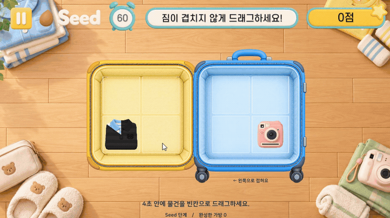

**과제:** 펼쳐진 가방에 물건을 놓고, 가방을 접었을 때 서로 겹치는지 판정해야 했습니다. 화면에 보이는 배치와 최종 판정이 일치하도록 구성했습니다.

- 좌우 가방의 칸을 접는 방향에 맞춰 **반사 좌표로 변환**하고, 최종 점유 칸의 중복을 검사했습니다.
- 한 칸 물건과 가로·세로 두 칸 물건을 구분해 **점유 영역 전체**를 판정했습니다.
- 정답은 가방 닫힘·점프·별 효과로, 오답은 닫히다 걸려 다시 열리는 동작으로 표현했습니다.
- 보상 지급을 가방 닫힘 결과에 연결하고, 재시작 시 이전 애니메이션을 정리했습니다.

**확인 항목:** 접힘 방향, 드래그 후 좌표, 여러 칸 물건의 겹침, 보상 지급 시점, 재시작 상태.

[좌표 변환과 피드백 상세](docs/bag-packing.md)

### 2. 모아이관찰 — 오답 생성 규칙 개선과 정답 유일성 검증

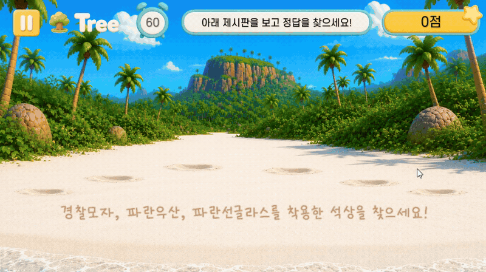

**문제:** 착용품 세 가지를 비교하는 단계에서도 정답만 특정 모자를 쓰고 있으면, 모자 하나만 보고 풀 수 있었습니다.

**해결:** 오답도 정답의 일부 조건을 공유하도록 생성 규칙을 변경했습니다. Tree 단계에서는 세 조건 중 두 개를 공유하고, 빠지는 조건을 순환시켜 전체 조합을 확인하도록 구성했습니다.

- 같은 착용 슬롯에 아이템이 중복되지 않도록 처리했습니다.
- 대체 아이템이 없을 때도 두 번째 정답이 생기지 않도록 예외 조건을 다뤘습니다.
- 기존 위치 교환, 점수·시간 규칙과 결과 JSON 구조를 유지했습니다.

**검증:** 실제 씬의 아이템 목록으로 **28개 세부 단계·총 2,800개 보드**를 생성해 정답 유일성, 공유 조건 수, 슬롯 중복을 검사했습니다. 생성 규칙 검사와 실제 플레이의 난이도·가독성 검토는 별도로 진행했습니다.

[오답 생성 기준과 검사 내용](docs/moai-observation.md)

## 공통 기능과 상태 관리

다른 개발자가 만든 게임에도 적용할 수 있도록 시작 설정, 결과 전송과 클릭 피드백의 책임을 나눴습니다.

| 직접 제작·연결한 기능 | 공통 컴포넌트의 책임 | 개별 게임의 책임 |
|---|---|---|
| 시작 난이도 수신 | 웹 요청 검증, 지원 단계 해석, 잘못된 값의 기본 처리 | 반환된 난이도를 문제 생성과 초기 상태에 적용 |
| 시행 결과 전송 | 공통 정보와 게임별 데이터를 JSON으로 구성하고 기존 WebGL 브리지 호출 | 문제·선택·정오답·시간을 결정하고 판정 시점에 전달 |
| 클릭 파티클 | 입력 위치를 Canvas 좌표에 맞춰 변환하고 공통 프리팹 재생 | 게임 씬에 배치하고 화면에 맞게 연결 |

웹에서 요청한 난이도와 실제 적용된 난이도를 구분해 기록했습니다. JSON 미리보기와 실제 웹 전송도 구분해 확인할 수 있도록 구성했습니다.

### 튜토리얼 스킵과 재시작 처리

게임마다 다른 진행 흐름을 확인하며 **안내 코루틴, 손가락 표시, dim, 입력 잠금, 트윈과 파티클**을 스킵·재시작 시 정리했습니다. 준비·시작 표시와 난이도 안내를 실제 게임 상태에 맞춰 연결했습니다.

```text
웹 시작 설정 → 공통 설정 수신 → 게임별 문제 생성
                                      ↓
                              입력 → 판정 → 피드백
                                      ↓
                       게임별 시행 데이터 → 공통 JSON 전송
```

[공통 컴포넌트의 책임·예외 처리·상태 관리](docs/shared-experience.md)

## UI 셰이더와 파티클

타이틀, 정답, 힌트와 남은 시간을 시각적으로 전달하는 효과를 제작하고 게임 진행에 연결했습니다.

| 적용 사례 | 구현과 제어 |
|---|---|
| 타이틀 쉬머 | Shader Graph에서 시간에 따라 빛 텍스처 UV를 이동. 속도·타일링·색상 조절 |
| 실루엣 색상 확산 | 중심으로부터의 거리와 반경으로 색상 확산 제어. 원본 윤곽·알파 유지 |
| 힌트 아웃라인 | 개별 머티리얼의 두께를 DOTween으로 변화시켜 해당 조각만 강조 |
| 정답·클릭 파티클 | 카드·정답·입력 위치에서 직접 제작한 효과 재생. 반복 재생 상태 정리 |
| UI 이미지 합성 | 물건의 남은 배치시간 표현, 도자기 문양의 크기·위치·불투명도 제어 |

새 문제·스킵·재시작에서 이전 트윈과 파티클을 정리하고 머티리얼 상태를 초기화했습니다. UI 셰이더에서는 Canvas 마스크와 알파 처리를 고려했습니다.

[셰이더·파티클 상세](docs/visual-effects.md) · [색상 확산 플레이](assets/gifs/shadow-kok/sprout-stage.gif) · [카드 매칭 피드백](assets/gifs/pair-match/sprout-stage.gif)

## 플레이 기록과 WebGL 연동

최종 점수만으로 구분하기 어려운 **오답 후 완료, 힌트 사용, 입력 순서와 반응시간**을 기록하도록 게임별 데이터와 판정 시점을 정했습니다.

| 설계한 구분 | 클라이언트 처리 |
|---|---|
| 바로 맞힌 경우 / 오답 후 완료 | 제시·입력 순서, 클릭 수, 정오답 기록 |
| 정확도 / 반응 속도 | 첫 반응시간과 클릭별 시간·선택 항목 기록 |
| 도움 없이 수행 / 힌트 사용 | 힌트 표시 여부 기록 |
| 세션 경과 / 문제 내 반응 | 시간 기준을 분리해 기록 |
| 재시도 / 시행 종료 | 게임별 규칙에 따라 시행 데이터를 확정하고 전송 |

클라이언트는 **수집·판정·전송**을 담당하고, 웹은 전달받은 기록을 분석·추천에 활용합니다. 고정 설정과 시행 결과를 구분하고, 정답·오답·재시도에서 기록의 중복과 누락을 확인했습니다.

[거품팡팡: 기록 항목·시간 기준·시행 종료 설계](docs/trial-data-design.md)

## 담당 콘텐츠 19종

| 테마 | 수 | 직접 개발한 콘텐츠 |
|---|---:|---|
| 호랑이 | 5 | 짝꿍찾기, 거품팡팡, 새모이주기, 히든캐치, 그림자콕 |
| 곰 | 4 | 색선게임, 선긋기게임, 시계그리기, 복잡한주문기억 |
| 토끼 | 3 | 넘어넘어동굴탐험, 하트모으기, 짐싸기게임 |
| 개구리 | 3 | 모아이관찰, 먹을까말까, 재활용분리수거 |
| 판다 | 4 | 몽글몽글 구슬공방, 도자기검사, 디자인패턴게임, 판다부동산 |

<details>
<summary><strong>19종 소개 이미지와 게임별 구현 항목 보기</strong></summary>

### 호랑이 테마 · 5종

| 콘텐츠 | 콘텐츠 | 콘텐츠 |
|---|---|---|
| **짝꿍찾기**<br>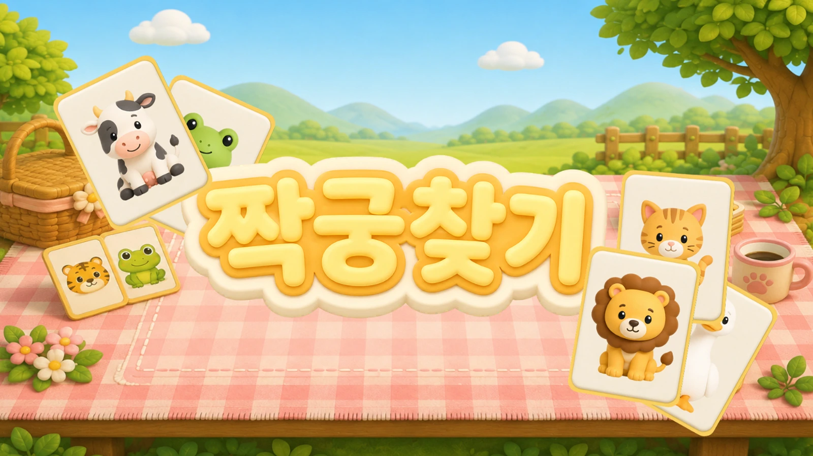<br>카드 위치를 기억하고 같은 그림의 짝 찾기<br><sub>카드 프리뷰·뒤집기, 매칭 판정과 입력 잠금</sub> | **거품팡팡**<br>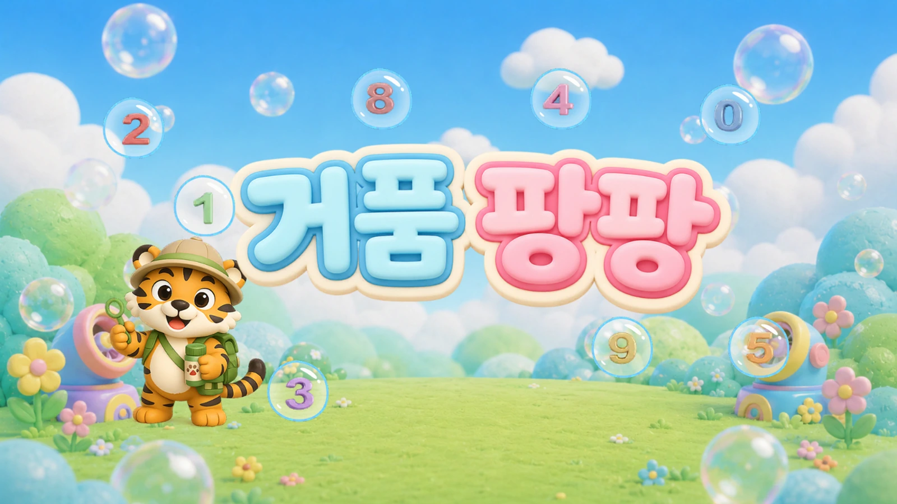<br>제시된 버블을 기억하고 규칙에 맞게 선택하기<br><sub>문제 노출·회상 입력 분리, 보드 단위 결과 기록</sub> | **새모이주기**<br>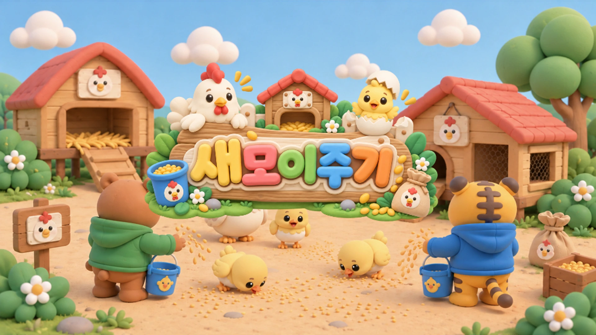<br>새마다 한 번씩, 제한된 모이를 나누어 주기<br><sub>먹이 수와 선택 이력 관리, 미급식 새의 후속 안내</sub> |
| **히든캐치**<br>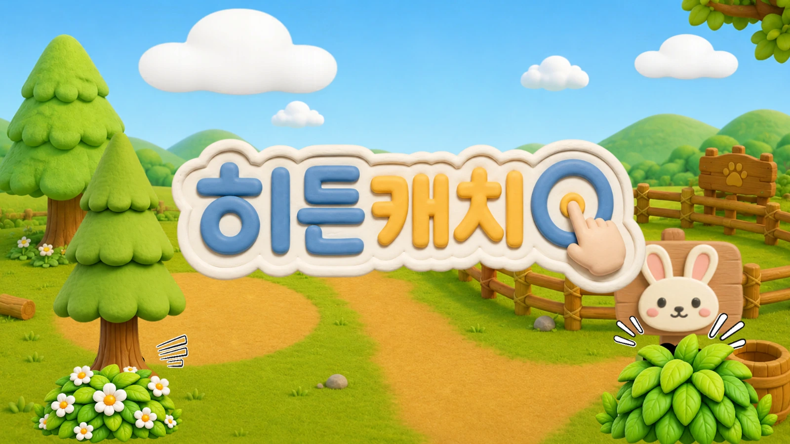<br>잠깐 본 동물을 기억하고 보기에서 찾기<br><sub>유사 오답 구성, 드래그 판정과 힌트</sub> | **그림자콕**<br>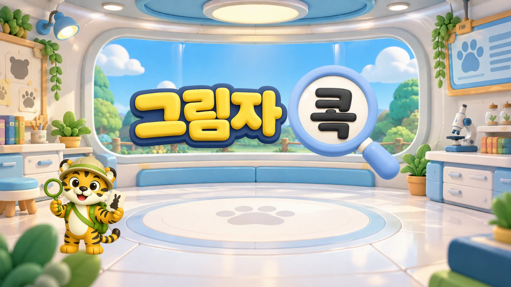<br>실루엣에 맞는 색상 조각을 옮기기<br><sub>드래그 앤 드롭, 색상 확산과 아웃라인 피드백</sub> |  |


### 곰 테마 · 4종

| 콘텐츠 | 콘텐츠 | 콘텐츠 |
|---|---|---|
| **색선게임**<br>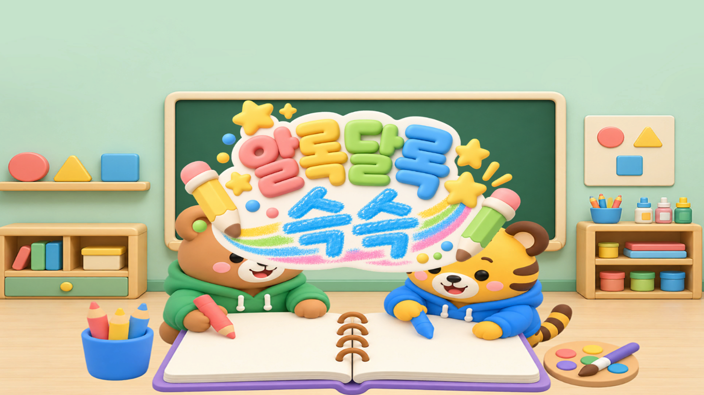<br>기억한 색을 선분에 맞춰 재현하기<br><sub>기억·재현 단계 분리, 선분별 색상 판정</sub> | **선긋기게임**<br>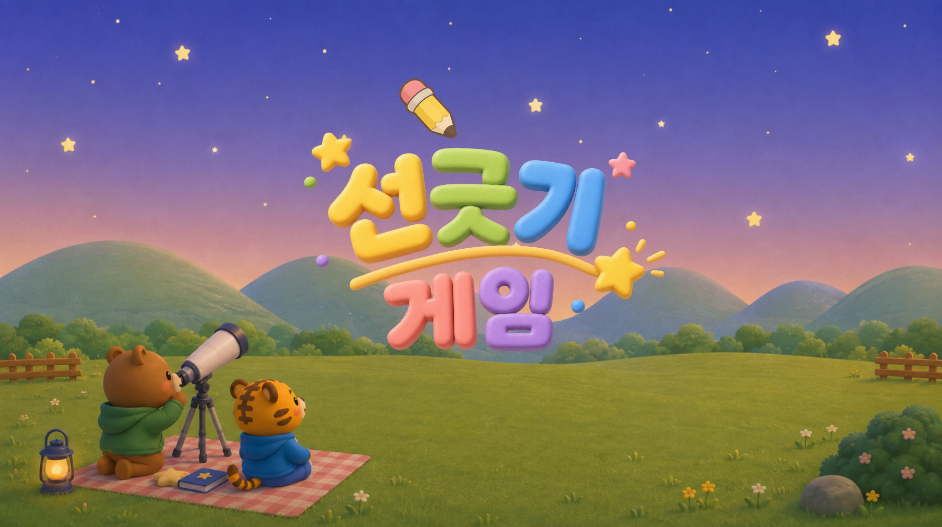<br>점을 순서대로 연결해 도형 완성하기<br><sub>절차적 도형 생성, 포인터 순서·해제 상태 관리</sub> | **시계그리기**<br>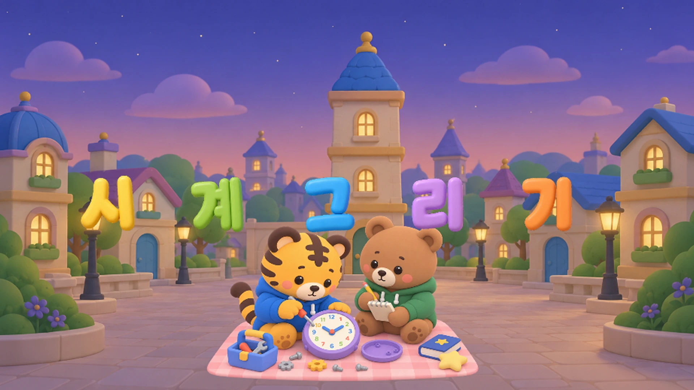<br>기억한 시간을 시계에 재현하기<br><sub>시·분침 각도 판정, 준비·시작과 안내 표시 순서</sub> |
| **복잡한주문기억**<br>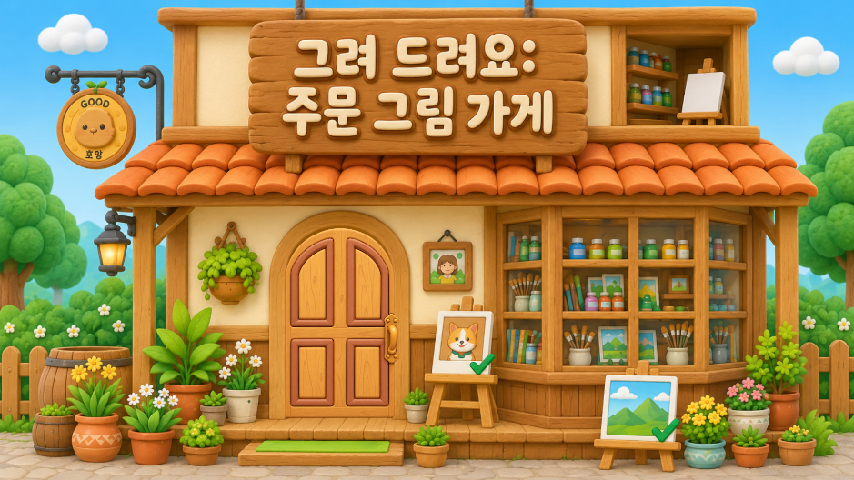<br>제시된 주문을 기억하고 그림으로 표현하기<br><sub>대화형 문제 제시, 그리기 입력과 판정 연동</sub> |  |  |


### 토끼 테마 · 3종

| 콘텐츠 | 콘텐츠 | 콘텐츠 |
|---|---|---|
| **넘어넘어동굴탐험**<br>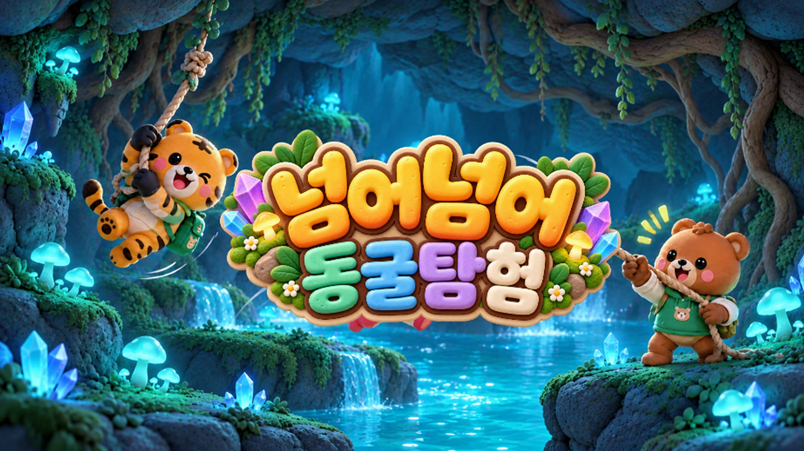<br>밧줄을 이용해 동굴 이동하기<br><sub>이동·낙하 상태, 튜토리얼 진행과 속도감 연출</sub> | **하트모으기 · 당근모으기**<br>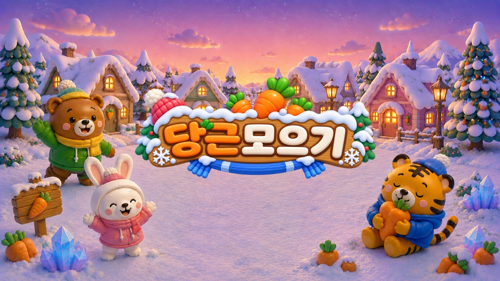<br>방향을 조작해 당근 수집하기<br><sub>보드 이동·수집 판정, 난이도 안내와 수집 위치 이펙트</sub> | **짐싸기게임 · 담아담아**<br>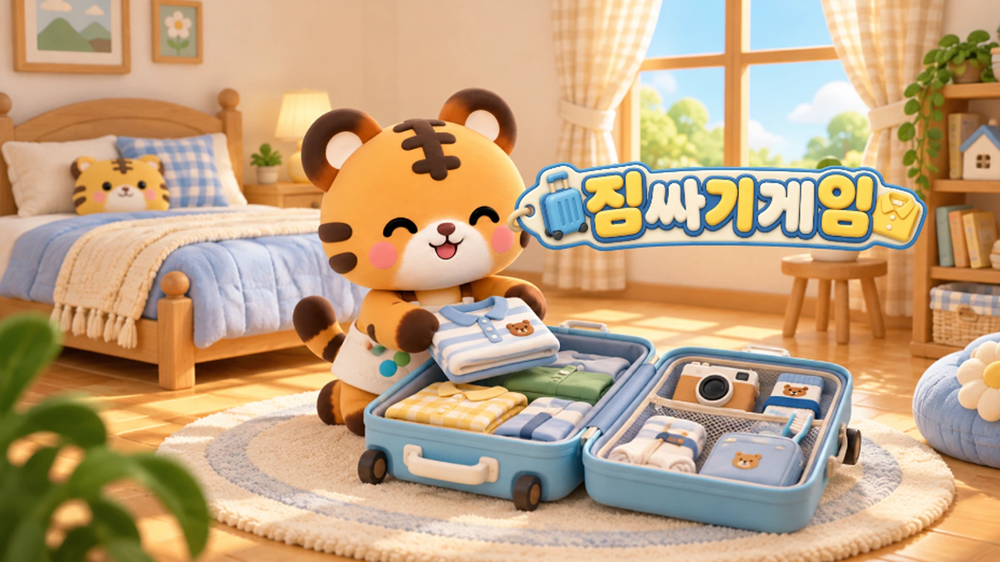<br>가방을 접어도 짐이 겹치지 않게 배치하기<br><sub>반사 좌표 기반 겹침 판정, 드래그와 가방 접기 연출</sub> |


### 개구리 테마 · 3종

| 콘텐츠 | 콘텐츠 | 콘텐츠 |
|---|---|---|
| **모아이관찰**<br>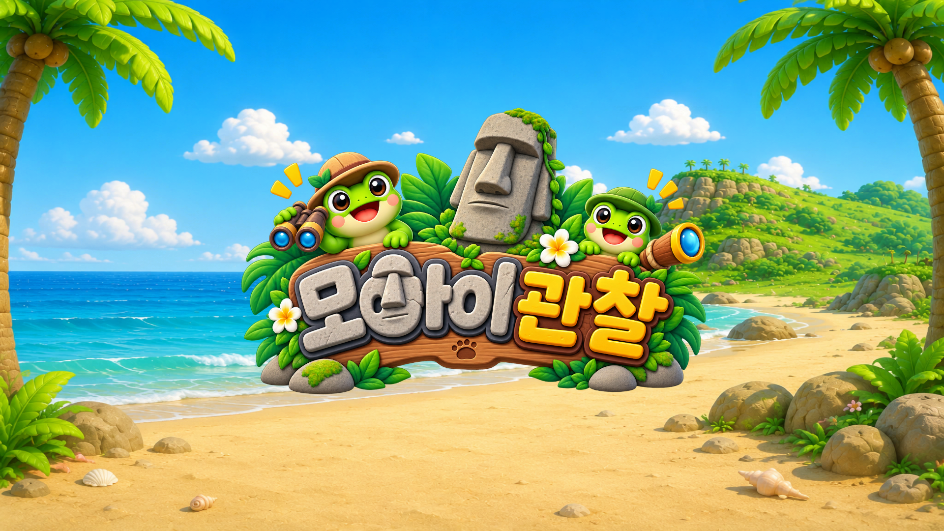<br>제시된 착용품 조합을 모두 갖춘 석상 찾기<br><sub>일부 조건이 같은 오답, 정답 유일성, 위치 교환</sub> | **먹을까말까**<br>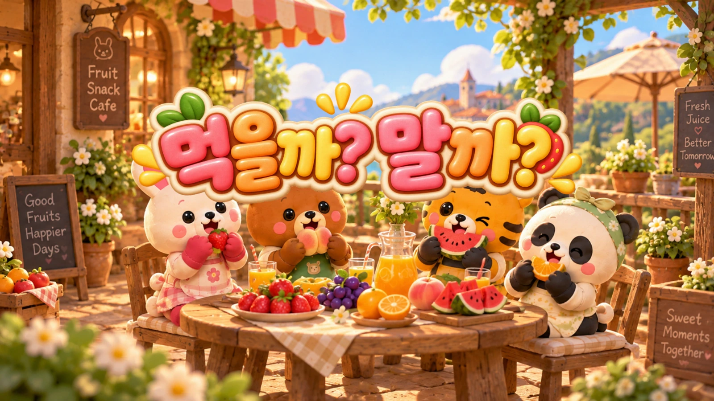<br>등장한 대상을 보고 반응 여부 판단하기<br><sub>자극 등장과 입력 시점, 정오답·반응시간 기록</sub> | **재활용분리수거**<br>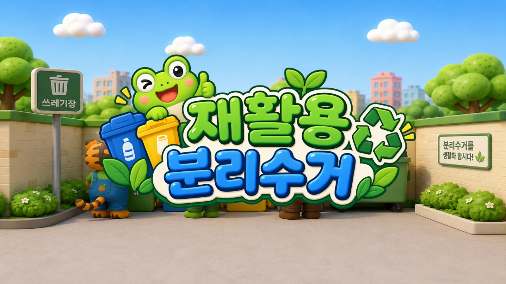<br>수거 규칙에 맞는 분리수거함으로 품목 옮기기<br><sub>품목·분류 데이터, 드롭 판정과 Editor 제작 도구</sub> |


### 판다 테마 · 4종

| 콘텐츠 | 콘텐츠 | 콘텐츠 |
|---|---|---|
| **몽글몽글 구슬공방**<br>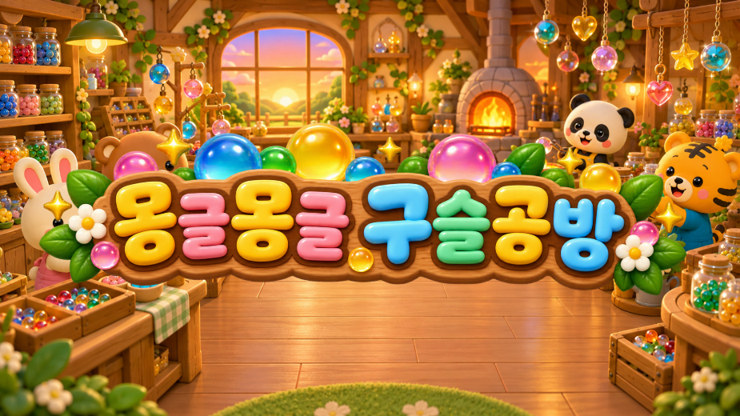<br>같은 구슬을 합쳐 더 큰 구슬 만들기<br><sub>물리 충돌·중복 합성 방지, 넘침 처리와 낙하 확률 조절</sub> | **도자기검사**<br>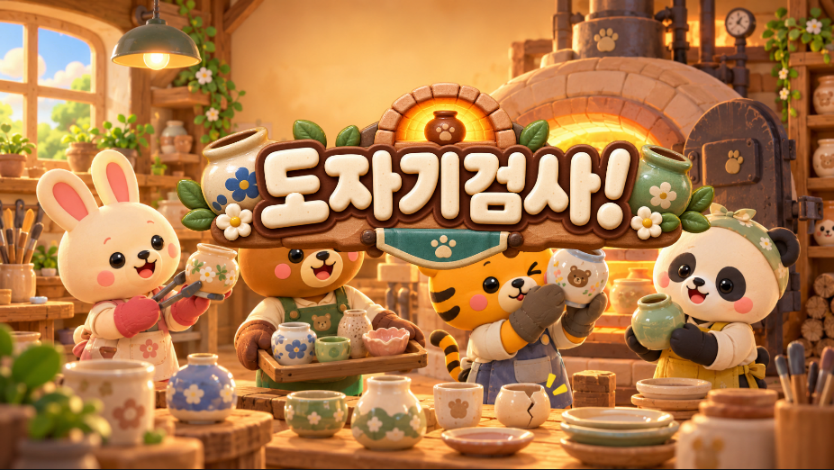<br>여러 도자기 중 기준과 다른 도자기 찾기<br><sub>색·크기·기울기 등 결함 조건과 선택 결과 기록</sub> | **디자인패턴게임**<br>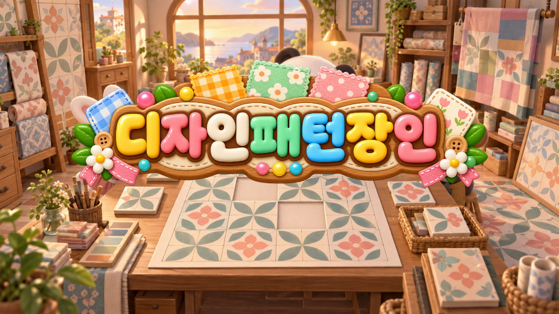<br>패턴의 빈 부분에 맞는 조각 선택하기<br><sub>오답 차이 구성, 문제 ID와 재시도 이력 기록</sub> |
| **판다부동산**<br>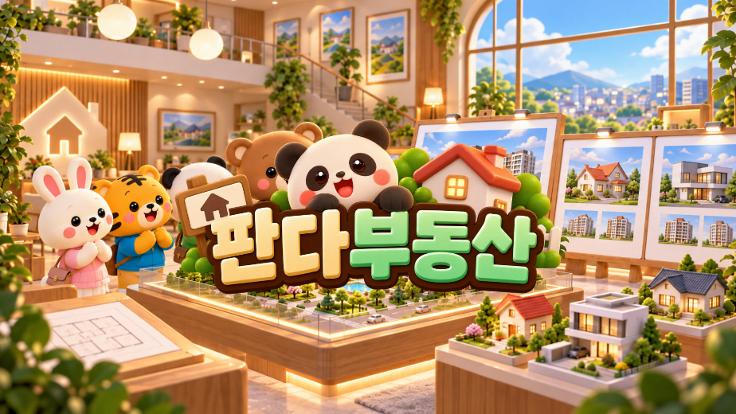<br>도면과 일치하는 입체 건물 선택하기<br><sub>투영 기반 보기 생성, 정답 유일성과 형태 구분</sub> |  |  |

</details>

담아담아는 현재 짐싸기 게임으로 변경되었습니다. 하트모으기는 당근 수집 표현을 사용합니다. 위 이미지는 콘텐츠 소개용이며 실제 동작은 플레이 GIF에서 확인할 수 있습니다.

## 추가 구현 자료

| 사례 | 확인할 내용 |
|---|---|
| [판다부동산](docs/find-my-house.md) | 투영 기반 보기 생성, 같은 정면으로 보이는 건물의 모호함과 정답 일관성 |
| [몽글몽글 구슬공방](docs/marble-workshop.md) | 물리 충돌과 중복 합성 방지, 넘침 상태, 낙하 확률 조절 |
| [짝꿍찾기](docs/pair-match.md) | 카드 프리뷰, 매칭 판정과 입력 잠금 |
| [히든캐치](docs/hidden-catch.md) | 유사 오답 생성, 드롭 판정과 힌트 |
| [그림자콕](docs/shadow-kok.md) | 드래그 앤 드롭, 색상 확산과 아웃라인 피드백 |
| [공개용 재작성 코드 예제](docs/core-implementation.md) | 선긋기 입력 상태, 원격 이미지 로딩과 로컬 폴백, ScriptableObject·Editor 제작 도구 |
| [이전 콘텐츠 흐름도](docs/content-flowcharts.md) | 당시 구현한 진행·판정 흐름 |

## 실행 가능한 독립 예제 · Fold Grid

짐싸기 개발 경험에서 다룬 **접힘 좌표 변환과 여러 칸 물건의 겹침 판정**을 별도 Unity 프로젝트로 재구성했습니다.

- **실행:** Unity 6000.3.10f1에서 `samples/fold-grid` 폴더를 프로젝트로 열고 `Assets/FoldGridDemo.unity` 실행
- **기능:** 1×1·2×1·1×2 물건의 클릭 배치, 접힌 좌표 표시, 충돌 검사, Undo·Reset
- **구조:** Unity에 의존하지 않는 판정 코드와 입력·표시 코드 분리
- **검증:** Unity 배치 실행에서 컴파일 및 좌표·경계·충돌 검증 4,767개 조건 통과. UI 수동 검증은 미실시

이 샘플은 실무 경험을 바탕으로 **Codex와 함께 새로 작성한 설명·학습용 코드**입니다. 회사 원본 코드·리소스를 포함하지 않으며, 당시 제품 코드를 그대로 공개한 자료가 아닙니다.

[실행 방법과 설계 설명](samples/fold-grid/README.md) · [판정 코드](samples/fold-grid/Assets/FoldGrid/FoldRules.cs) · [검증 코드](samples/fold-grid/Assets/Editor/ValidateFoldGrid.cs)

## 사용 기술과 자료 범위

- **클라이언트:** Unity, C#, UGUI, TextMeshPro
- **연출:** DOTween, ParticleSystem, Shader Graph, ShaderLab/HLSL
- **데이터·연동:** ScriptableObject, UnityWebRequest, WebGL Interop
- **버전 관리:** Git

생성형 AI는 코드 탐색·구현 후보 작성·검사 보조에 활용했습니다. 요구사항과 설계 기준을 제시하고, 플레이 결과와 로그를 검토해 수정 방향을 결정했습니다. 외부 UI 아트·썸네일·음원 활용과 직접 제작한 셰이더·파티클 및 클라이언트 구현을 구분합니다.

짐싸기·모아이 GIF는 2026년 11월 녹화본이며, 히든캐치·그림자콕·짝꿍찾기 GIF는 이전 버전으로 최신 UI와 일부 차이가 있을 수 있습니다. 재작성 예제의 이전 난이도 정책과 주문·카트 흐름은 당시 사례이며, 현재 19종 전체의 공통 규칙을 뜻하지 않습니다.

[자료 공개 정책](docs/evidence-policy.md) · [이전 포트폴리오 기록 · 2026년 9월](docs/portfolio-history-202609.md)

**양원규 · Unity Client Developer**
