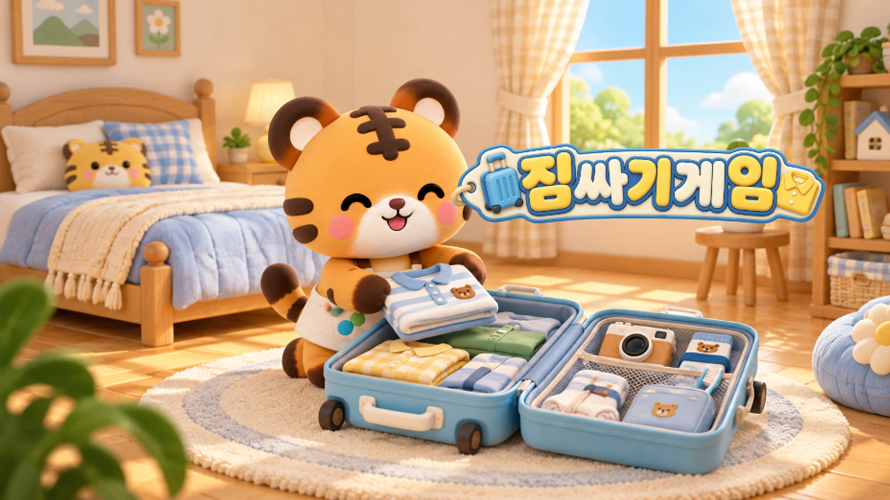
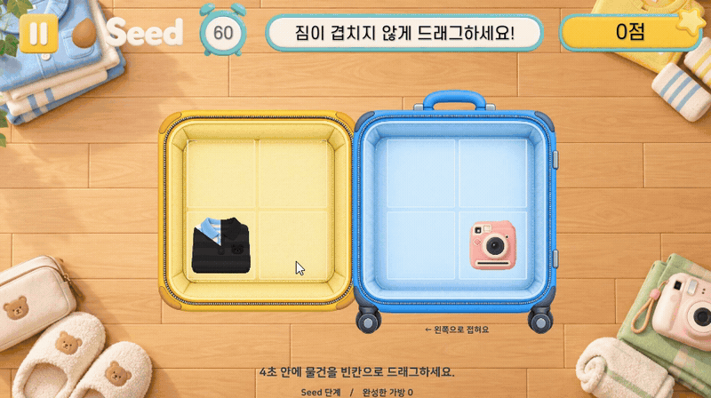

# 짐싸기게임 · 담아담아 — 접힘 판정과 결과 연출

## 실제 플레이

드래그 배치 → 가방 접힘 → 정답 피드백을 담은 실제 플레이입니다. 2026년 11월 녹화본에서 발췌했으며, 웹으로 전달되는 JSON은 영상에 별도로 표시하지 않습니다.

담아담아가 짐싸기 게임으로 변경되어 토끼 테마에 배치된 현재 콘텐츠입니다. 기존 주문·카트 방식의 서비스 연동 기능을 이 게임의 구현으로 설명하지 않습니다.

## 핵심 규칙

펼쳐진 가방에서 플레이어의 한 칸짜리 물건을 드래그해, 가방을 접었을 때 고정된 물건과 겹치지 않도록 놓습니다. 고정 물건에는 한 칸짜리 외에 세로 두 칸·가로 두 칸 물건을 사용합니다. 이동 가능한 물건과 고정 물건의 역할을 구분했습니다.

## 구현: 펼친 좌표를 접힌 좌표로 변환

좌우 가방의 칸을 접는 방향에 맞춰 반사한 뒤, 같은 최종 칸에 물건이 겹치는지 판정합니다. 고정 물건은 점유 칸 전체를 기준으로 검사하고, 표시 이미지는 원본 비율을 유지해 해당 영역에 배치합니다. 칸 수와 가방 구성, 고정 물건 수를 난이도에 반영했습니다.

## 피드백: 결과와 닫히는 동작을 연결

- 정답: 닫힌 가방의 짧은 점프·착지와 별이 퍼지는 연출, 중앙의 간결한 성공 문구를 연결합니다.
- 오답: 가방이 닫히려다 걸리고 튀어 열리는 DOTween 동작으로 겹침을 표현합니다.
- 물건 이미지 위의 어두운 채움이 줄어드는 방식으로 배치 제한시간을 나타냅니다.
- 성공 시간 보상은 물건을 놓은 직후가 아닌 가방 닫힘 결과에 연결하고, 전체 시간의 상한을 유지합니다.
- Leaf부터 오답 시간 감점을 적용하며, 초반 단계에는 같은 감점을 강제하지 않습니다.

## 공통 경험과 연결

테마 텍스트박스, 튜토리얼 손가락, 건너뛰기 버튼, 준비·시작과 난이도 안내를 기존 게임 양식에 맞췄습니다. 공통 테스트 패널은 수정하지 않고 게임 측 연결을 통해 레벨 변경·강제 판정 등 테스트 기능을 사용하도록 했습니다.

## 검토 기준

접힘 방향과 손잡이 방향, 점유 칸 판정, 드래그 후 좌표, 재시작 시 애니메이션 정리, 보상의 지급 시점을 함께 확인합니다. 소개 이미지는 플레이 검증 화면이 아니며, 입력과 실제 가방 닫힘은 플레이로 확인해야 합니다.

[README로 돌아가기](../README.md)
