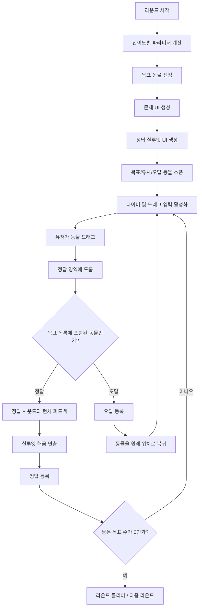
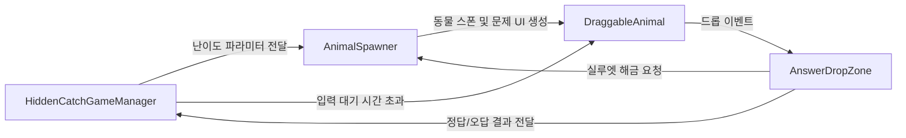
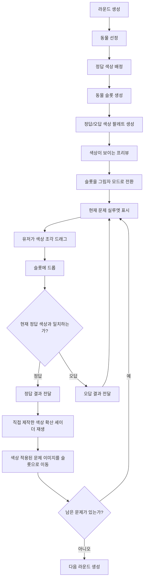
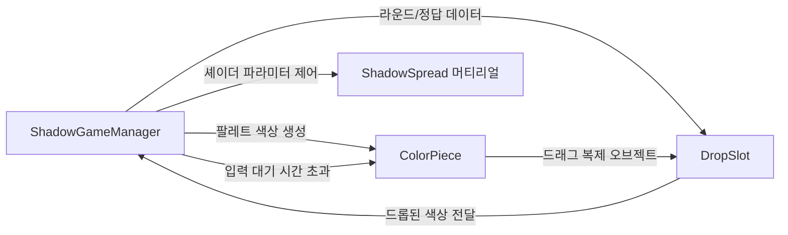
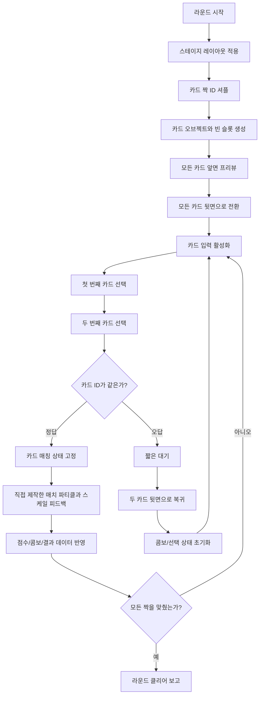
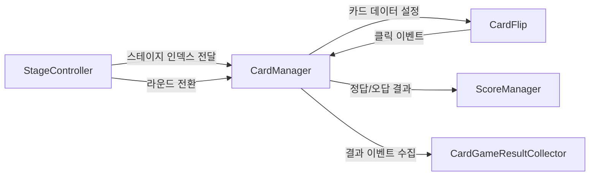

# Content Flowcharts

이 문서는 세 콘텐츠의 구현 흐름을 채용자가 빠르게 확인할 수 있도록 정리한 것입니다.

원본 회사 코드는 포함하지 않고, 공개 가능한 수준의 구조 설명과 흐름도만 제공합니다.

## Hidden Catch

### Gameplay Flow

### Responsibility Flow

## Shadow Kok

### Gameplay Flow

### Responsibility Flow

## Pair Match

### Gameplay Flow

### Responsibility Flow

