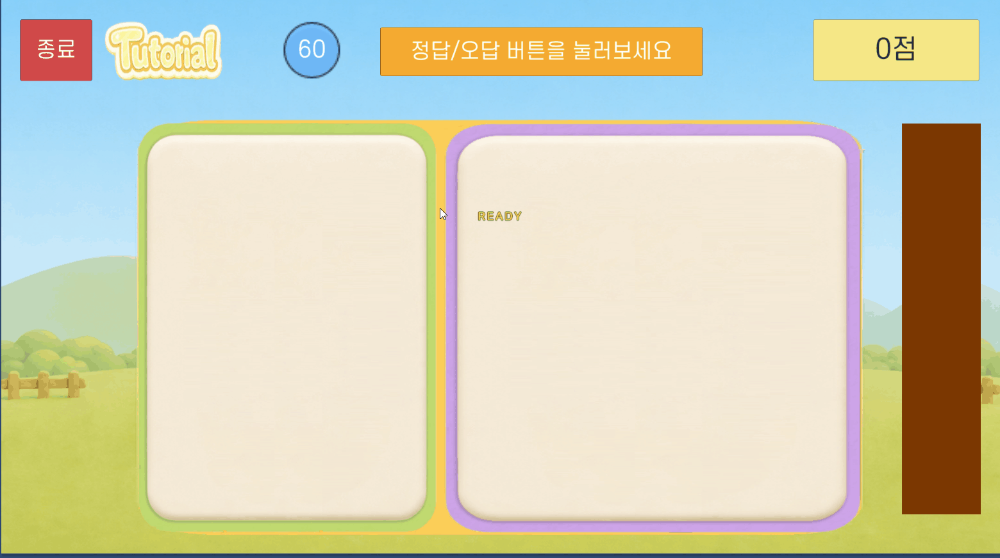
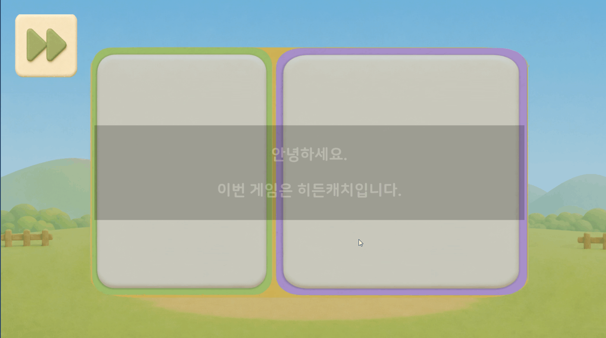
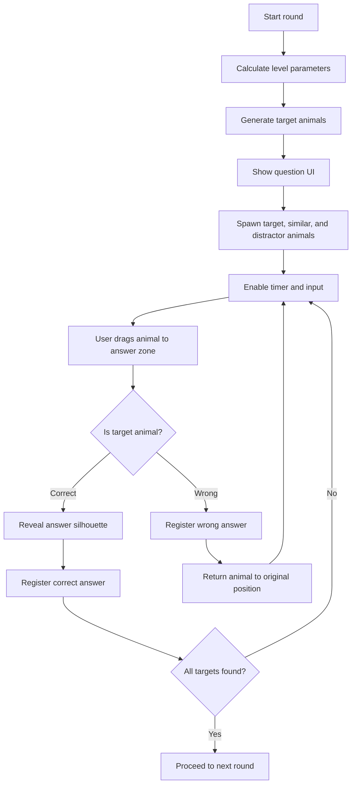

# Hidden Catch

## Summary

여러 동물 중 문제로 제시된 동물을 찾아 정답 영역에 드래그 앤 드롭하는 Unity 미니게임입니다.

구현의 핵심은 단순한 드래그 기능이 아니라, 난이도별 문제 구성, 정답/오답 판정, 정답 실루엣 해금 연출, 힌트 시스템, 라운드 진행 상태를 하나의 흐름으로 관리하는 것입니다.

## Media

## Responsibilities

- 난이도에 따른 목표 동물 수, 전체 스폰 수, 유사 동물 수, 문제 노출 시간 제어
- 문제 동물 UI와 정답 실루엣 UI 생성
- 드래그 앤 드롭 기반 정답/오답 판정
- 정답 시 실루엣을 실제 이미지로 전환하는 연출 구현
- 일정 시간 입력이 없을 때 정답 동물에 아웃라인 힌트 표시
- 정답/오답 결과를 공통 게임 매니저 흐름으로 전달

## Main Classes

- `AnimalSpawner`
  - 라운드 시작 시 문제 동물 선정, 문제 UI 생성, 정답 실루엣 생성, 동물 스폰을 담당합니다.
  - 난이도에 따라 목표 수와 스폰 수를 받아 화면에 배치합니다.
  - 정답 처리 시 `RevealAnswer`로 실루엣을 실제 이미지로 바꾸고 DOTween/ParticleSystem 연출을 실행합니다.

- `HiddenCatchGameManager`
  - 공통 게임 매니저를 상속해 Hidden Catch 전용 라운드 흐름을 제어합니다.
  - 난이도별 파라미터를 계산하고, 스폰 완료 이후에 타이머/입력 가능 상태를 시작합니다.
  - 정답/오답을 공통 결과 처리 API로 전달합니다.
  - 입력이 없을 때 정답 동물 아웃라인 힌트를 실행합니다.

- `AnswerDropZone`
  - 드롭된 동물이 현재 목표 목록에 포함되는지 판정합니다.
  - 정답이면 정답 연출, 실루엣 해금, 정답 등록, 드래그 비활성화를 처리합니다.
  - 오답이면 오답 등록 후 동물을 원래 위치로 되돌립니다.

- `DraggableAnimal`
  - 동물 UI의 드래그 입력, 드래그 중 스케일 연출, 원위치 복귀, 힌트 아웃라인 머티리얼을 관리합니다.

## Flow

## Development Notes

### Difficulty Control

난이도별로 목표 동물 수, 전체 스폰 수, 유사 동물 수, 문제 제시 시간을 분리해 관리했습니다. 이를 통해 같은 게임 규칙을 유지하면서도 단계가 올라갈수록 기억 부담과 탐색 난이도가 높아지도록 구성했습니다.

### Input And State Timing

문제 UI가 표시되는 동안에는 실제 탐색 타이머가 시작되지 않도록 하고, 동물 스폰이 완료된 뒤에 `isRunning`과 `roundStartTime`을 갱신했습니다. 이렇게 해서 유저가 아직 조작할 수 없는 연출 시간이 기록에 섞이지 않도록 했습니다.

### Presentation

정답을 맞추면 실루엣 UI가 흰색 이미지로 전환되고, 스케일 반응과 파티클이 함께 재생됩니다. 정답 판정과 시각 피드백을 분리해 정답 처리 흐름을 명확하게 유지했습니다.

### Hint System

일정 시간 입력이 없으면 아직 찾지 못한 정답 동물 중 하나를 골라 아웃라인 머티리얼의 두께를 DOTween으로 반복 변화시킵니다. 입력이 다시 발생하면 진행 중인 힌트 Tween을 종료하고 상태를 초기화합니다.

## Public Disclosure

이 문서는 구현 흐름 설명용입니다. 회사 프로젝트의 원본 C# 코드와 내부 리소스는 공개 저장소에 포함하지 않습니다.
