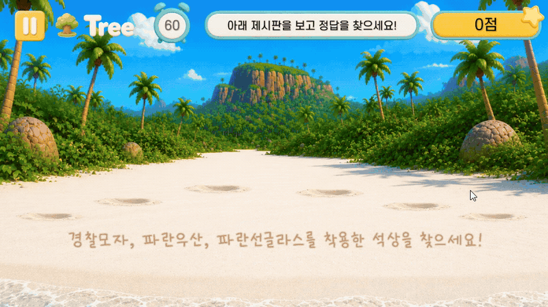

# 모아이관찰 · 일부 조건이 같은 오답 설계

## 실제 플레이

Tree 단계의 유사 착용품, 위치 교환과 선택 결과가 보이는 실제 플레이입니다. 2026년 11월 녹화본에서 발췌했으며, 웹으로 전달되는 JSON은 영상에 별도로 표시하지 않습니다.

## 문제: 세 가지 조건을 제시해도 하나만 보면 풀린다

제시판의 착용품을 모두 갖춘 모아이를 고르는 게임입니다. Tree에서는 세 가지 조건과 석상 위치 교환을 사용하지만, 정답만 특정 모자를 쓰고 있다면 모자 하나를 찾는 것만으로 정답을 고를 수 있었습니다. 이동 연출만으로는 조합 비교의 난이도를 확보할 수 없었습니다.

## 변경: 정답의 일부 조건을 오답도 공유

Sprout·Leaf의 오답은 제시 조건 두 개 중 하나를 공유하고, Tree의 오답은 세 개 중 두 개를 공유하도록 변경했습니다. 빠지는 조건을 오답마다 순환시켜 어떤 아이템을 비교하느냐에 따라 답이 달라지지 않게 했습니다.

| 보기 예시 | 모자 | 우산 | 안경 |
|---|---|---|---|
| 정답 | 간호사 | 무지개 | 빨강 |
| 오답 A | 간호사 | 무지개 | 파랑 |
| 오답 B | 간호사 | 분홍 | 빨강 |
| 오답 C | 경찰 | 무지개 | 빨강 |

이 표는 설명용 예시입니다. Tree에서는 두 조건의 조합도 오답에 나타나므로 세 조건을 모두 확인해야 합니다. Seed는 한 조건을 비교하는 쉬운 구성을 유지합니다.

## 구현 기준

- 정답 조합에서 바꿀 조건을 고르고 같은 착용 슬롯의 다른 아이템으로 교체합니다.
- 모자·안경 등 같은 슬롯에 아이템 두 개가 들어가 화면에서 덮어쓰이지 않도록 합니다.
- 추가 장식은 제시 조건에 포함되지 않은 아이템과 비어 있는 슬롯에서 고릅니다.
- 대체 아이템이 없는 경우 조건 하나를 제외해 두 번째 정답이 생성되지 않게 합니다.
- 기존 위치 교환, 점수·시간 규칙과 결과 JSON 구조는 유지했습니다.

## 검증과 한계

실제 씬의 아이템 목록으로 28개 세부 단계에서 총 2,800개 보드를 생성해 검사했습니다. 정답이 하나인지, 오답의 공유 조건 수가 맞는지, Tree의 각 두 조건 조합이 오답에도 있는지, 추가 장식을 포함해 슬롯 중복이 없는지 확인했습니다.

이 검사는 생성 규칙의 일관성을 확인합니다. 플레이 난이도와 가독성은 실제 플레이로 추가 조정할 대상이며, 사용자의 인지 능력 개선 효과를 측정한 검사는 아닙니다.

[README로 돌아가기](../README.md)
