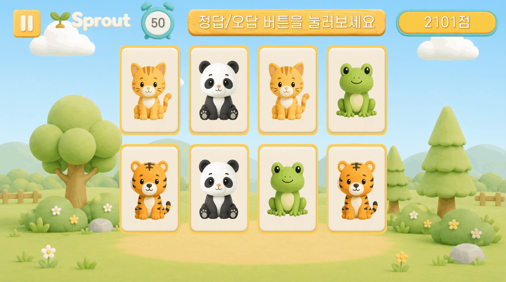
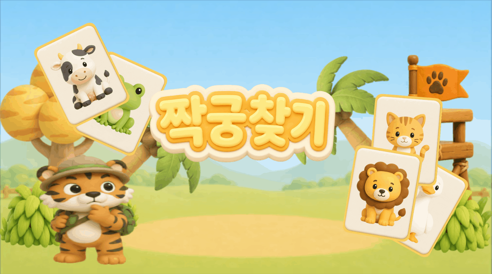
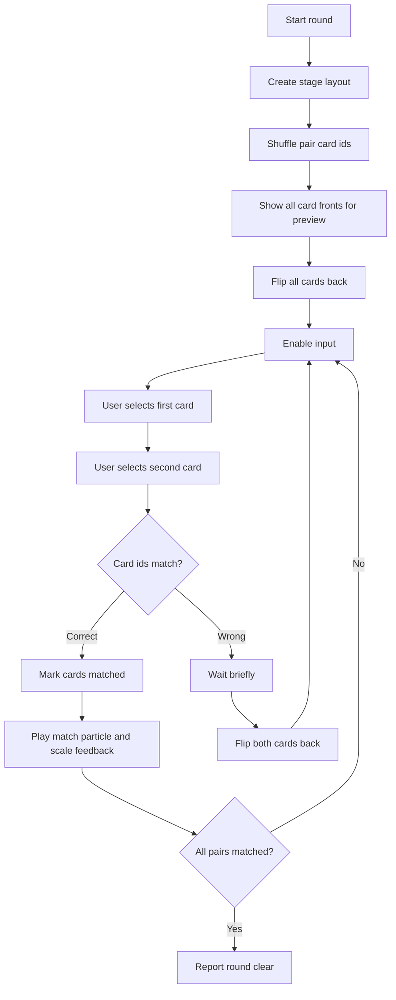

# Pair Match

## Summary

카드를 일정 시간 보여준 뒤 뒤집고, 유저가 기억을 바탕으로 같은 카드 쌍을 맞추는 Unity 미니게임입니다.

구현의 핵심은 난이도별 카드 배치, 프리뷰와 플립 연출, 입력 잠금, 매칭 판정, 자동 힌트, 점수/콤보/결과 데이터 수집 흐름입니다.

## Media

## Responsibilities

- 난이도별 카드 수, 컬럼 수, 빈 슬롯을 포함한 레이아웃 구성
- 카드 프리뷰 후 일괄 뒤집기 처리
- 카드 클릭 입력, 첫 번째/두 번째 선택 상태 관리
- 정답/오답 비교 중 입력 잠금
- 정답 시 매치 처리, 파티클, 스케일 연출
- 오답 시 일정 시간 후 카드 되돌리기
- 콤보 점수와 결과 데이터 수집
- 일정 시간 입력이 없을 때 자동 힌트 실행

## Main Classes

- `CardManager`
  - 스테이지별 카드 생성, 그리드 크기 보정, 프리뷰, 카드 선택, 매칭 판정, 자동 힌트를 담당합니다.
  - `isPreviewTime`, `isComparing`, `isAutoHintRunning` 상태로 입력 가능 여부를 제어합니다.

- `CardFlip`
  - 카드 앞/뒤 전환을 DOTween 스케일 애니메이션으로 처리합니다.
  - 매칭 완료 상태와 튜토리얼 모드 분기를 관리합니다.

- `StageController`
  - 현재 스테이지를 설정하고, 라운드 종료 후 다음 라운드로 전환합니다.
  - 공통 레벨 값을 받아 난이도에 맞는 스테이지 인덱스로 연결합니다.

- `ScoreManager`
  - 정답 콤보에 따른 점수 증가와 팝업 표시를 담당합니다.
  - 콤보 단계에 따라 사운드 피드백을 분기합니다.

- `CardGameResultCollector`
  - 시도 횟수, 정답/오답 횟수, 패널티, 콤보, 소요 시간을 수집해 결과 데이터로 구성합니다.

## Flow

## Development Notes

### Layout And Difficulty

각 스테이지는 컬럼 수, 전체 슬롯 수, 카드 쌍 수, 빈 슬롯 목록을 별도로 가집니다. 빈 슬롯을 더미 오브젝트로 채워 GridLayoutGroup의 구조를 유지하면서 카드 배치 형태를 조정했습니다.

### Input Lock

프리뷰 중이거나 두 카드를 비교하는 중에는 추가 입력이 들어오지 않도록 `isPreviewTime`과 `isComparing`으로 입력을 차단했습니다. 이를 통해 카드가 세 장 이상 열리거나 비교 도중 상태가 꼬이는 상황을 방지했습니다.

### Feedback

정답 시 카드 매칭 상태를 고정하고 파티클과 스케일 반응을 재생합니다. 오답 시 짧은 대기 후 두 카드를 다시 뒤집어 유저가 선택 결과를 확인할 수 있게 했습니다.

### Result Tracking

라운드마다 시도 횟수, 정답/오답 횟수, 콤보, 소요 시간을 수집해 결과 데이터로 구성했습니다. 단순 화면 구현이 아니라 게임 진행 기록을 남길 수 있는 형태로 흐름을 연결했습니다.

## Public Disclosure

이 문서는 구현 흐름 설명용입니다. 회사 프로젝트의 원본 C# 코드와 내부 리소스는 공개 저장소에 포함하지 않습니다.
