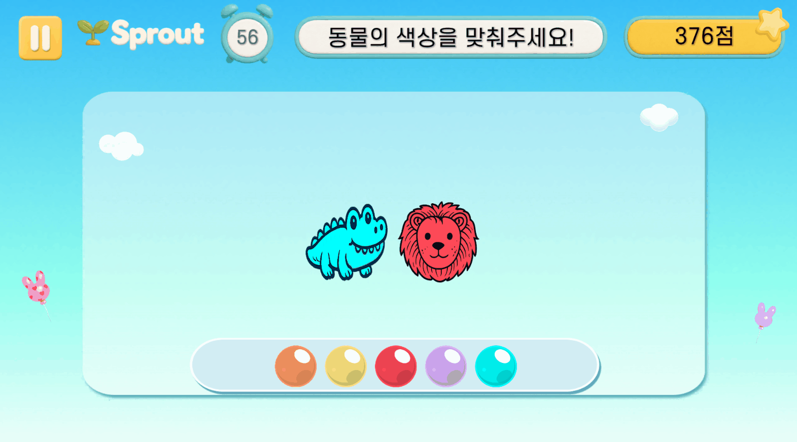
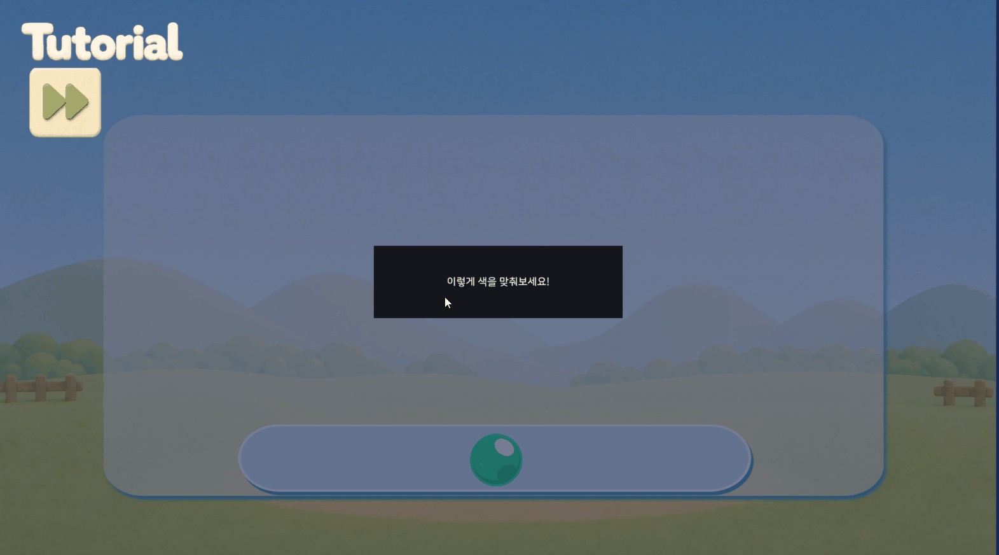
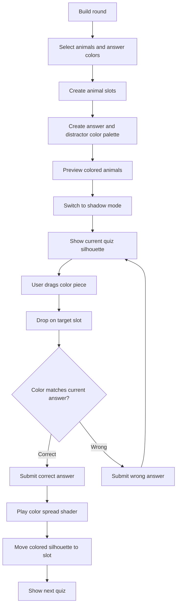

# Shadow Kok

## Summary

동물 실루엣과 색상 팔레트를 보고 알맞은 색상 조각을 드래그해 정답을 맞추는 Unity 미니게임입니다.

핵심 구현은 동물/색상 라운드 생성, 색상 팔레트 구성, 드래그 앤 드롭 입력, 정답 색 확산 연출, 자동 힌트 처리입니다.

## Media

## Responsibilities

- 난이도별 동물 수, 팔레트 색상 수, 프리뷰 시간을 조절
- 정답 색상과 오답 색상을 섞어 색상 팔레트 생성
- 색상 조각 드래그 시 복제 오브젝트를 생성해 원본 팔레트는 유지
- 드롭 영역에 색상 조각을 놓았을 때 현재 문제의 정답 색과 비교
- 정답 시 색상이 실루엣으로 확산되는 셰이더 연출 실행
- 일정 시간 입력이 없으면 정답 색상 조각에 아웃라인 힌트 표시

## Main Classes

- `ShadowGameManager`
  - 라운드 생성, 동물 슬롯 생성, 정답 색상 매핑, 팔레트 생성, 정답 판정을 담당합니다.
  - 공통 게임 매니저 흐름과 연결해 정답/오답 결과를 전달합니다.
  - 정답 시 색상 확산과 슬롯 이동 연출을 실행합니다.

- `ColorPiece`
  - 팔레트 색상 조각의 드래그 입력을 처리합니다.
  - 드래그 시작 시 루트 캔버스에 복제 오브젝트를 만들고, 원본 팔레트는 유지합니다.
  - 드롭 실패 시 바운스 연출 후 복제 오브젝트를 제거합니다.
  - 힌트용 아웃라인 머티리얼을 인스턴스화해 각 조각별로 안전하게 제어합니다.

- `DropSlot`
  - 색상 조각이 슬롯에 드롭되었을 때 튜토리얼 모드와 본게임 모드를 분기합니다.
  - 본게임에서는 `ShadowGameManager.CheckAnswer`로 색상 판정을 위임합니다.

## Flow

More diagrams: [Content Flowcharts](content-flowcharts.md#shadow-kok)

## Development Notes

### Round Generation

난이도에 따라 동물 수와 팔레트 수를 다르게 설정했습니다. 정답 색상은 현재 동물의 색상에서 가져오고, 나머지 팔레트는 다른 색상 그룹에서 가져와 오답 후보로 섞었습니다.

### Drag Clone Pattern

색상 팔레트 원본을 직접 이동하지 않고, 드래그 시작 시 복제 오브젝트를 생성했습니다. 이렇게 하면 팔레트 UI는 고정된 상태를 유지하고, 드래그 중인 오브젝트만 드롭 판정에 사용됩니다.

### Shader Presentation

정답 시 `Custom/ShadowSpread` 셰이더의 `_Radius`와 `_TargetColor` 값을 제어해 검은 실루엣에서 정답 색상으로 퍼지는 연출을 구현했습니다. 이후 해당 실루엣을 정답 슬롯 위치로 이동시키며 결과를 시각적으로 연결했습니다.

### Hint System

입력이 없는 상태가 일정 시간 지속되면 현재 문제의 정답 색상 조각을 찾아 아웃라인 두께를 반복 변화시킵니다. 입력이 들어오면 기존 힌트 Tween과 머티리얼 상태를 정리해 힌트가 중복되지 않도록 했습니다.

## Public Disclosure

이 문서는 구현 흐름 설명용입니다. 회사 프로젝트의 원본 C# 코드와 내부 리소스는 공개 저장소에 포함하지 않습니다.
