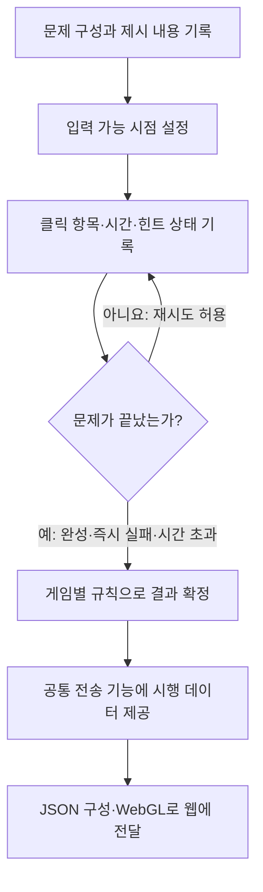
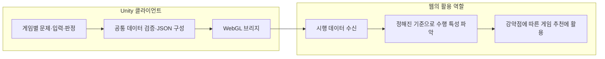

# 거품팡팡 · 추천에 필요한 수행 데이터를 설계한 이유

## 목표에서 수집 항목으로

사용자의 수행 특성과 영역별 강약점을 파악해 게임 추천에 활용하려면, 점수와 최종 성공 여부만으로는 정보가 부족합니다. 거품팡팡에서는 제시된 순서를 기억하고 버블을 누르는 동안의 선택·오답·힌트·시간을 기록하도록 구성했습니다.

핵심은 **같은 문제를 끝냈어도 수행 과정은 다를 수 있다**는 점입니다. 오류 없이 바로 누른 경우, 여러 번 틀린 뒤 완성한 경우, 힌트를 보고 완성한 경우를 구분할 수 있도록 기록 항목을 정했습니다. 기록은 행동의 관찰값이며 사용자가 정확히 기억했는지, 추측했는지를 단일 값만으로 확정하지 않습니다.

## 내가 맡은 판단과 구현 연결

| 단계 | 결정·수행한 내용 | 이유 |
|---|---|---|
| 목적 정의 | 추천에 사용할 수 있는 수행 정보가 필요하다고 판단 | 점수만으로 사용자의 어려움과 도움 사용 여부를 구분하기 어려움 |
| 수집 항목 설계 | 제시 순서·응답 순서·클릭별 시간·정오답·힌트 기록 | 결과와 그 결과에 도달한 과정을 함께 남김 |
| 시간 기준 구분 | 세션 경과시간과 입력 가능 시점부터의 반응시간을 분리 | 문제 제시·연출을 포함한 시간과 실제 입력 시간을 혼동하지 않음 |
| 게임별 규칙 정의 | 오답 후 계속 입력하는 게임과 바로 종료하는 게임을 구분 | 같은 성공·실패 표현이 게임마다 다른 의미가 되는 상황 방지 |
| 공통 기능 연결 | 게임별 데이터는 게임에서 제공하고 JSON·WebGL 전달은 공통 기능으로 처리 | 다른 개발자의 게임에도 전송 구조 적용 |
| 확인과 수정 | 정답·오답·무응답 로그를 실제 플레이와 비교 | 누락·중복과 측정 시점의 불일치 확인 |

요구사항과 원하는 결과를 먼저 정의하고, 생성형 AI를 탐색·구현·검사 보조에 활용했습니다. 구현 결과는 정한 기준과 실제 플레이 로그를 비교해 수정했습니다.

## 기록 항목과 의미

| 항목 | 기록 내용 | 필요한 이유 |
|---|---|---|
| `trial_no`, `level` | 문제 순번과 해당 문제의 난이도 | 서로 다른 문제·난이도 조건 구분 |
| `presented_seq` | 실제 제시한 버블 순서 | 무엇을 기억하고 재현해야 했는지 확인 |
| `response_seq` | 정답·오답을 포함한 실제 클릭 순서 | 틀린 선택과 중간 입력까지 확인 |
| `tap_ms` | 입력 가능 시점부터 각 클릭까지의 누적 시간 | 클릭 사이 간격과 입력 흐름을 선택 항목에 대응 |
| `rt_ms` | 입력 가능 시점부터 첫 클릭까지의 시간 | 최초 반응 속도 기록. 첫 클릭이 정답이라는 의미는 아님 |
| `elapsed_ms` | 첫 본 게임 버블이 표시된 뒤 해당 문제의 첫 버블이 표시될 때까지의 세션 경과시간 | 세션 안에서 문제가 제시된 시점 기록 |
| `is_correct` | 완성된 문제에서 실수 없이 수행했는지 판정. 시간 초과·무응답 등 미완료는 `null` | 완료와 오류 없는 수행, 미완료를 구분 |
| `aid_shown` | 문제 중 힌트가 표시됐는지 | 도움 제공 조건을 함께 기록 |
| 라운드의 `attempt_count`, `correct_count`, `wrong_count` | 버블 클릭 시도와 정답·오답 클릭 수 | 문제 단위 판정과 클릭 단위 집계를 구분 |

`response_seq[i]`와 `tap_ms[i]`를 대응시키면 어느 클릭이 언제 발생했는지 볼 수 있습니다. `tap_ms`는 클릭 간격 자체가 아니며, 인접 값의 차이가 클릭 사이 간격입니다. 마지막 클릭 시간은 마지막 입력 시점으로 해석하고 모든 경우에 정답 완료 시간으로 단정하지 않습니다.

## 예시 · 정답을 모두 눌렀어도 오류 없는 수행과는 다름

다음은 필드 관계를 설명하기 위해 만든 **가상 데이터**입니다. 실제 참여자의 식별자·이름·세션 기록은 포함하지 않습니다.

```json
{
  "attempt_count": 4,
  "correct_count": 3,
  "wrong_count": 1,
  "trials": [
    {
      "trial_no": 2,
      "level": "1-1",
      "elapsed_ms": 12000,
      "rt_ms": 900,
      "is_correct": false,
      "aid_shown": false,
      "presented_seq": [2, 7, 5],
      "response_seq": [2, 9, 7, 5],
      "tap_ms": [900, 1400, 2100, 3000]
    }
  ]
}
```

설명에 필요한 필드만 발췌한 예시이며 전체 전송 형식을 뜻하지 않습니다.

| 관찰 | 기록으로 확인하는 내용 |
|---|---|
| 첫 반응 | 입력 가능 후 900ms에 첫 클릭 |
| 중간 오입력 | 1,400ms에 다음 정답 7 대신 9 선택 |
| 이후 수행 | 남은 정답 7과 5를 클릭해 순서 완성 |
| 문제 단위 결과 | 오답이 있었으므로 `is_correct: false` |
| 해석의 차이 | 정답 3개를 모두 눌렀다는 집계만으로 무실수 수행으로 판단하지 않음 |

## 게임마다 다른 종료 규칙

공통으로 만드는 것은 전송 기능입니다. **trial이 언제 확정되는지는 게임 규칙에 맞춰 결정**합니다.



| 상황 | 거품팡팡 대표 처리 | 다른 게임에 연결할 때의 기준 |
|---|---|---|
| 중간 오답 | 선택과 시간을 남기고 오답 수를 증가시킨 뒤 계속 입력 | 즉시 종료 규칙이면 그 시점에 결과 확정 |
| 순서 완성 | 실수 없이 완성했는지까지 포함해 문제 판정 | 각 게임의 성공 조건으로 판정 |
| 시간 초과 | 미완료를 `null`로 구분하고, 발생한 부분 입력은 보존 | 해당 게임의 미완료·실패 규칙에 맞춰 기록 |
| 무응답 | 빈 응답 배열, 첫 반응시간 `null`과 판정 `null`로 구분 | 클릭하지 않은 문제도 기록 대상인지 명시 |
| 힌트 | 표시 여부를 함께 남김 | 힌트 제공 조건과 성공 판정을 구분 |

## 두 종류의 시간

```text
세션 경과 기준: 첫 본 게임 버블 표시 ───────────────────────▶
                                    ↑ 해당 문제 제시 시점의 elapsed_ms

문제 입력 기준: [순서 제시·대기] → 입력 가능 ─────────────────▶
                                           ├─ 첫 클릭: rt_ms
                                           └─ 클릭별 시점: tap_ms
```

거품팡팡의 `elapsed_ms`는 각 문제의 풀이 소요시간이 아닙니다. 세션의 첫 자극 표시를 시작점으로, 해당 문제의 첫 자극 표시 시점에 기록합니다. 이후 문제 제시·전환·안내·일시정지의 실제 경과도 이어집니다. `rt_ms`와 `tap_ms`는 입력 가능 시점부터 게임 내 시간 기준으로 기록하므로 두 시계를 같은 값처럼 취급하지 않습니다.

## 클라이언트와 웹의 역할



제가 담당한 설명 범위는 **추천에 필요한 수집 항목과 게임별 기록 기준을 정의하고, Unity의 판정·시간·전송을 연결하는 것**입니다. 웹의 추천 계산이나 인지 능력 평가 알고리즘을 이 클라이언트 구현의 기여로 포함하지 않습니다. 기록한 행동 지표는 웹에서 활용할 근거이며, 개별 사용자의 인지 능력을 확정하는 진단 결과로 주장하지 않습니다.

[공통 컴포넌트와 연결 방식](shared-experience.md) · [README로 돌아가기](../README.md)
