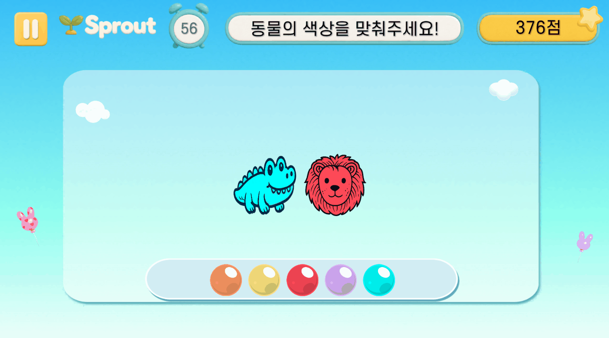
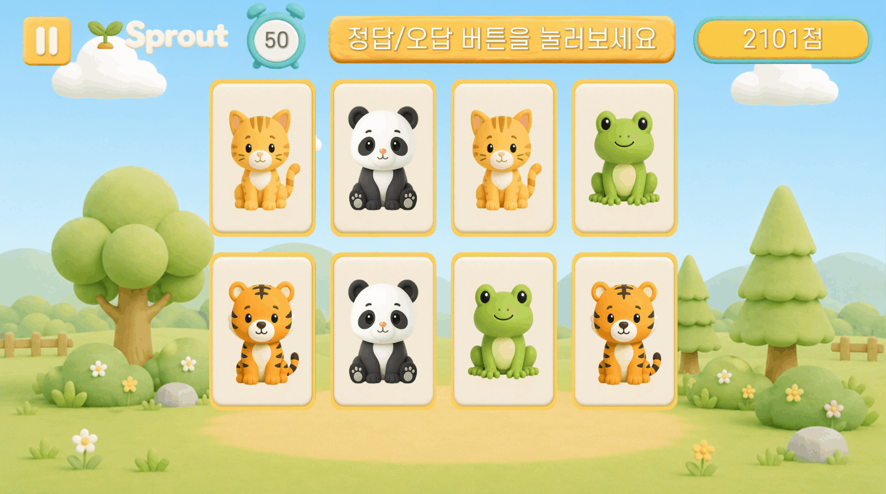
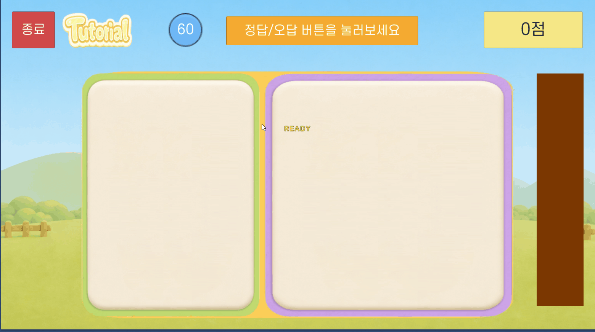

# 셰이더·파티클 — 게임 상태를 보이게 만드는 피드백

타이틀의 빛 연출부터 정답·힌트·남은 시간까지, 게임의 상태에 맞춰 셰이더·머티리얼·파티클과 DOTween을 연결했습니다. 아래는 기존 구현 문서와 프로젝트의 실제 연결을 확인한 사례입니다.

## 짝꿍찾기 · 타이틀 쉬머

타이틀 라벨 위로 밝은 빛이 반복해서 지나가는 **쉬머(Shimmer)** 효과를 Shader Graph로 제작했습니다. `TitleShimmerShader`는 시간에 따라 빛 텍스처의 UV를 이동시키고 타이틀 이미지와 합성합니다. 그래프는 속도, 타일링, 빛 색상과 빛 텍스처를 조절하도록 구성했으며 실제 짝꿍찾기 씬의 머티리얼에 연결되어 있습니다.

정적인 타이틀 이미지에 움직임을 더하는 작업으로, 아래의 정답 파티클과는 별도의 연출입니다. 이 문서에 타이틀 쉬머만을 촬영한 새 영상은 아직 포함하지 않았습니다.

## 그림자콕 · 실루엣에서 정답 색상으로 확산

`Custom/ShadowSpread`에서 이미지 중심으로부터 거리를 계산하고 `_Radius`와 `_TargetColor`로 색상이 퍼지는 범위와 색상을 제어했습니다. 경계는 부드럽게 보간하고 원본 텍스처의 검은 윤곽과 알파는 유지해 동물의 세부 형태가 사라지지 않도록 했습니다.

정답 판정 뒤 색상 확산, 정답 파티클, 슬롯 이동이 이어지도록 게임 흐름에 연결했습니다. 다음 문제에서는 반경을 초기화해 이전 결과가 남지 않도록 합니다.

### 힌트 아웃라인

색상 조각마다 머티리얼 인스턴스를 사용하고, `_Thickness`를 DOTween으로 변화시켜 힌트를 표시합니다. 한 조각의 강조가 다른 조각에 동시에 적용되지 않도록 머티리얼 상태를 분리했습니다.

[그림자콕 상세 설명](shadow-kok.md)

## 짝꿍찾기 · 카드 위치에서 정답 파티클

매치 성공 시 직접 제작한 파티클을 카드 위치에서 재생하고, 카드의 스케일 반응과 콤보 팝업을 연결했습니다. 파티클은 이전 재생 상태를 정리하고 다시 재생해 반복 매칭에서도 피드백이 보이도록 처리했습니다.

[짝꿍찾기 상세 설명](pair-match.md)

## 히든캐치 · 해금과 클릭 피드백

드롭 정답 판정 뒤 실루엣 해금, 스케일 반응과 직접 제작한 정답 파티클을 연결했습니다. 공통 클릭 피드백에는 별·하트 계열 파티클 머티리얼을 사용합니다. 클릭 화면 좌표를 활성 Canvas에 맞게 변환하고, 자식 파티클을 함께 재생하는 방식으로 여러 게임에서 재사용했습니다.

[히든캐치 상세 설명](hidden-catch.md)

## UI 규칙에 맞춘 셰이더와 효과 위치

| 적용 게임 | 구현·조정 내용 | 플레이에서 전달하는 정보 |
|---|---|---|
| 짐싸기게임 | 물건 스프라이트를 어두운 흑백으로 표시하는 UI 셰이더와 `Radial360` 채움 이미지를 겹쳐, 채움이 줄어들며 원래 색이 드러나도록 구성 | 배치에 남은 시간 |
| 도자기검사 | 도자기 스프라이트에 문양 텍스처를 합성하고, 문양 크기·위치·불투명도를 개별 머티리얼에서 제어 | 비교해야 할 문양 조건 |
| 당근모으기 | 토끼 위치에 있던 수집 파티클을 당근의 실제 위치에서 재생하도록 변경. 수집 직후 보드가 갱신돼도 효과가 끝까지 보이도록 레이어 분리 | 어느 당근이 수집됐는지 |

짐싸기·도자기 UI 셰이더에서는 Canvas의 마스크·알파 처리를 고려했고, 당근 수집 효과는 기존 파티클의 재생 위치와 수명을 조정한 사례로 구분합니다.

## 연출의 상태 관리

효과를 보이게 만드는 것 외에 반복 플레이에서 이전 효과가 남지 않는지도 확인합니다. 정답 판정과 효과 재생의 순서를 연결하고, 새 문제·스킵·재시작 시 트윈, 머티리얼 상태와 생성한 파티클을 정리합니다. 소개 영상은 구현 동작을 보여주며 성능 수치나 인지 효과 측정 결과를 대신하지 않습니다.

[README로 돌아가기](../README.md)
